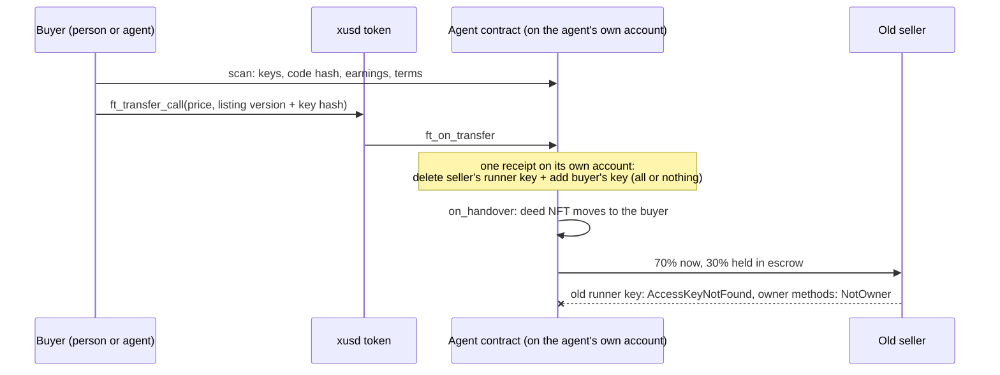

# Agent Exit

**Sell an AI agent with earnings a buyer can check on-chain and a handover that locks the seller out: one NEAR transaction swaps the keys, moves the ownership deed and pays out.**

> **All money here is fake.** Payments use `xUSD-FAKE`, a test token with no
> value that this repo deploys (`contracts/xusd`). Nothing runs on mainnet.

## Try it

```
make setup     # once: fetch crates and npm packages (the only networked step)
make demo      # offline story: verify subset, then a scripted agent-buys-agent replay
make web       # open http://127.0.0.1:8080 : six recorded steps, break-in first
```

## One sale



## Evidence

- **Proven on a real node:** the `tests/sandbox` tests (key list before and after the buy, the old runner key and the deleted setup key failing with the node's own error, a failed key batch refunding the buyer) passed on a local NEAR node (near-sandbox) at commits `609b135` and `63d597c`. Rerun: `make test-sandbox`.
- **Offline, every time:** 60 scenarios replayed through the real contract code against checked-in goldens (`make verify`), property tests, 51 MCP tests and 6 script tests. All offline results use a mocked runtime or JSON fixtures.
- **Attack suite:** 19 attack families, each blocked by the rule written for it; 0/50 false positives on clean agents — a regression suite, not independent evidence. A9 (open Base authorization) is excluded from what is claimed until Base is live, and A5 (wrong code hash) uses a placeholder hash until the reproducible build exists. The suite was written by the same author as the rules.
- **Found and fixed on a real node (A47).** A stress run on a local NEAR node (12d1ab7) bricked an agent at about 585 distinct payers: every call then trapped (`unreachable`) while loading state. The offline tests had not seen it because they use a mock runtime with no limits of a real node. The exact cause is unconfirmed (likely one allocation over 64 KiB while decoding the payer map); the fix removes every growable map from the state blob (payer and day rows are separate storage entries, so the blob stays the same size) and covered by the sandbox test `a47_thousand_long_payers_then_buy_and_views` (1,000 payers of 64 characters, then a buy and every view) plus offline regressions. A49 then made a payer row cost 0.002 NEAR (`storage_deposit`) so outsiders cannot make the agent pay for storage with free test tokens. This was found by our own run, not by an independent audit.
- **Testnet: coming.** Contract ids, a real `buy()` transaction and the old seller's rejected transaction will be linked here as explorer links. None exists yet.
- **No AI model in the loop yet.** The agent-buys-agent run is a scripted replay; `make llm-buyer` runs a real model through the MCP tools and writes `out/llm-buyer.json`; the real model run is pending on testnet day, and until then the page has an empty slot for the real AI buyer transcript.

AI agents: start with [`AGENTS.md`](AGENTS.md) and [`llms.txt`](llms.txt).

---

## The problem, and what the contract does

AI agents that earn money will be bought and sold. Today a buyer can trust
neither the numbers nor the handover: earnings can be faked by paying your own
agent, and a seller can keep a spare key and come back later. On NEAR an agent
can be its own account, so its keys, code and every payment it receives are
public. Agent Exit puts one contract on the agent's account that:

1. **counts earnings** by payer and day and flags payments from the seller,
   the seller's sub-accounts and round trips;
2. **hands the agent over in one transaction**: the ownership deed (an NFT)
   moves, the seller's runner key is deleted and the buyer's is added, all or
   nothing;
3. **pays the seller 70% now and holds 30% in escrow**, released only from
   real revenue after the sale. Silence pays a small floor; a proven backdoor
   cuts the rest;
4. **runs the agent as a business inside the owner's limits**: the agent has
   its own treasury, every incoming payment is split automatically, and the
   agent can pay other agents only to allowed payees and up to a daily cap.
   Spending policy enforced by the contract; buying the agent means taking
   over who sets the limits.

Other agents can do all of this through an MCP server (`mcp/`) and an Agent
Skill (`skills/agent-exit/SKILL.md`) that always scans before it buys.

Every claim below says whether it is shown offline, on a local NEAR node, or
on testnet.

## Rerun it (humans and AI agents)

Requirements: Rust (the pinned toolchain in `rust-toolchain.toml` installs
itself through rustup) and `make`; Node >= 20 for the MCP server. No NEAR
account, no network after the first `make setup` (`cargo fetch` + `npm ci`).

| Do | See |
|---|---|
| `make demo` | The offline story in one command: the verify replay (60 scenarios, both goldens), the scripted agent-buys-agent replay, then how to open the page. Faster than `make verify` (no cargo test run). |
| `make verify` | Unit + property tests pass, then the fixed world replays through the real contract code and `out/verify.json` equals `tests/golden/verify.json`, and the attack report equals `tests/golden/attack.json` (`... output equals ...` lines on stderr). About 1 min warm, longer on a cold build; offline. |
| `cargo run -q -p verify` | A PASS/FAIL table, one row per scenario id (S*, E*, A*). |
| `cargo run -q -p verify -- --json` | The same as JSON (`verify-output.v1`). |
| `make attack` | A regression suite, not independent evidence: 200 seeded variants of 19 attack families (each blocked by the rule written for it) and 50 clean agents through the client scan, plus the contract's own refusals. Table on stderr, `out/attack.json` (`attack-report.v1`), with 0/50 false positives, and the "not caught by design" rows N1-N6. (The tool's own summary line still uses the older wording "in scope: 200/200 blocked".) `N=`, `SEED=`, `CLEAN=` change the corpus. |
| `make attack FIXTURE=fixtures/judge-attack.json` | Scan **your own** planted agent: edit the fixture (instructions inside it), rerun, see its verdict and findings in the `judge` section. As committed it is clean. |
| `make scan FILE=fixtures/scan/cheat.json` | One scan report (`scan-report.v1`); exit 0 clean, 2 blocked, 3 inconclusive. The cheat agent is blocked for `full_access_key_present`. |
| `make mcp-test` | The MCP server's tests offline (51 tests, then 6 script tests: S14 agent buys agent, S15 resale, E29 refusals, E30 read-only without keys, never-mainnet, schemas, Skill), then the scripted run equals `tests/golden/agent-buys-agent.json`. |
| `make llm-buyer` | A real model (NEAR AI Cloud, else Anthropic) reads the Skill and buys through the MCP tools against the offline fixtures -> `out/llm-buyer.json`. Needs an API key in `~/.agent-exit.env`; exits 2 without one. The server, not the model, enforces `max_price`, `confirm` and the spend cap. **Real model run pending on testnet day**: no transcript is committed. |
| `make agent-buys-agent` | A scripted replay (no AI model decides anything): the `summarizer` agent, as an MCP client, lists agents, sees `cheat`'s earnings are fake, gets its buy refused (`SCAN_BLOCKED`), scans `translator` clean, buys it (`max_price` 1000, `confirm`), checks `alice` is locked out and lists the agent again. `out/agent-buys-agent.json` (`agent-buys-agent.v1`). |
| `make mcp` | Start the MCP server on stdio. Offline by default; write tools need `AGENT_EXIT_ALLOW_WRITE=1` and `AGENT_EXIT_ACCOUNT_ID` (`buy_agent` also `AGENT_EXIT_RUNNER_PK`). Config for Claude Code and Codex: [`AGENTS.md`](AGENTS.md). |
| `make web` | The demo page at http://127.0.0.1:8080: the six demo steps (break-in fails, the business inside its limits, verified vs unverified earnings, a cheat caught, an honest sale, a scripted replay of an agent buying an agent, with a slot for the real AI buyer transcript), each with the contract's real error text or event JSON. Offline by default: it shows `web/data/demo.json`, **recorded from the contract code** by `make web-data` (reproducible). `?network=testnet` shows the testnet mode: a NEAR wallet login (NEAR Connect) and the label `testnet: coming after deploy`; nothing is read from or sent to the chain yet. |
| `make web-test` | Playwright smoke test of the page in Chromium (desktop and 375 px wide, external requests blocked): every step's key result is on screen, no horizontal scroll, no console errors, the testnet flag is labelled. Needs the `playwright` npm package with Chromium; not part of `make ci`. |
| `make fuzz` | Property-based fuzzing (proptest) of everything an outsider controls: the `ft_on_transfer` msg (random bytes, random JSON, mutated real pay/buy msgs), NEAR AI proofs, `set_limits` arguments and MPC `sign` answers. No panic, full refund or accepted, never a forged verified badge, books stay solvent. `FUZZ_CASES=3000` per target (about 6 min). |
| `make deploy-testnet DRY_RUN=1`, `make gates DRY_RUN=1`, `make scenes DRY_RUN=1` | Offline: print exactly what the testnet day will do, step by step, which secrets each step needs (by name) and which file it writes. Refuses an env file that names anything but testnet. |
| `make test` | All tests (`PROP_CASES=10000` property cases, fixed seed). |
| `make lint` | `rustfmt --check` and `clippy -D warnings`. |
| `make audit` | `cargo audit` (needs `cargo install cargo-audit`). Four advisories in near-sdk's native test runtime are ignored in `.cargo/audit.toml`; the same target proves those crates are not in the contract wasm. |
| `make test-sandbox` | Builds the wasm (`cargo-near`) and runs `tests/sandbox` on a real local node: key list before/after the buy, the old runner key and the deleted setup key failing with the node's error (S5, A17, A21), and a failed key batch refunding the buyer (E5). **Passed on a local NEAR node at `609b135` and `63d597c`.** Needs a machine that can raise the open-file limit near-sandbox needs. |
| `make help` | Every target. Targets that are not built yet are marked `(not built yet)` in the help and exit 1. |

AI agents: start with [`AGENTS.md`](AGENTS.md) and [`llms.txt`](llms.txt).

## What is proven, and where

| Claim | How it is shown | Scenario ids |
|---|---|---|
| The meter separates real from faked earnings: the fixed world shows gross 500.00, counted 360.00, **verified 120.00**, flagged 140.00 (self 100.00, seller sub-account 40.00); a cheat agent with 500.00 gross counts 0.00 | offline (contract in mocked runtime) | S2, S4, A10, A11, A12 |
| NEAR Verified: a payment carrying a NEAR AI Cloud-style signature over `model:sha256(request):sha256(response)` is checked in the contract (EIP-191 hash, `env::ecrecover`, signer on an admin-set list, request names this agent and job, each signature once). A failed proof still counts, only without the badge | offline, **with TEST signatures** made by a local key (`fixtures/test-signatures/`, labelled; reproducible). The real NEAR AI signer is checked on the owner's machine (gate G6) | S3, E11-E14, A13, I9 |
| Backdoor scan: an extra full-access key, a key the contract did not add, a wider-scoped runner key, a wrong code hash, an upgrade or self-deploy method, an unpublished method, open approvals, an open Base authorization, a listing-version mismatch, a changed price, earn-out terms below the minimum, the wrong admin or token, or a frozen agent each block the sale; RPC providers disagreeing makes it inconclusive (refuse) | offline, from JSON fixtures; `make attack` is a regression suite (19 attack families, each blocked by the rule written for it; 0/50 false positives on clean agents), not independent evidence; A9 (Base) excluded until Base is live, A5 uses a placeholder hash | S1 (client), A1-A9, A21, A23, E31, E34 |
| The contract keeps enforcing on its own: listing version and key hash at buy, approvals at listing, token origin, deed transfer, hidden keys | offline (`make attack` contract section) | A7, E2, A8, A14, A16, A23 |
| One `buy()` moves the deed, deletes the seller's runner key, adds the buyer's function-call key, pays 700.00 and escrows 300.00 | offline: the contract emits exactly that key batch and payout. Real key deletion on a node: `make test-sandbox` (passed on a local NEAR node at `609b135` and `63d597c`) | S5, A17 |
| All-or-nothing: if the key batch fails, state is restored and the buyer is refunded in full; if the payout fails it becomes claimable | offline (callbacks driven with success and failure) | E5, E6, I1, I6 |
| Stale listing, changed keys, underpay, low gas, malformed msg, a second buy while settling: refused with a full refund | offline | E1-E4, E7, E10, A7 |
| Earn-out: 50% of each counted post-sale payment, floor 20% of escrow at window end, cap at escrow; wash payments release nothing | offline + property tests | S7-S10, E20, E21 |
| A self-call signed by a key the contract never added freezes the agent and returns the open escrow to the buyer | offline | A23 |
| Old seller after the sale: withdraw and deed transfer refused `NotOwner` | offline (contract part) | A19, A22 |
| Security review 1 fixes: no key-batch gap lets the buyer or owner fake a backdoor (keys being added or deleted are `incoming`/`retiring` until a callback confirms; a call signed by one is `NotRunner`, never a freeze); admin, token and signer list are compiled in, shown in `get_status`, and the scan blocks a mismatch (`registry_mismatch`); a NEAR Verified signature binds payer, amount and job; selling, cancelling, key rotation and limits need 1 yoctoNEAR; the seller's unwithdrawn revenue is settled to the seller at the sale; round-trip tracking refuses new destinations instead of silently saturating | offline (regression tests are the reviewer's attacks with inverted asserts, `contracts/agent/src/review_regressions.rs`) + property tests | A25-A30 |
| Security review 2 fixes: a round trip the buyer creates after the sale does not stop the seller's earn-out (only pre-sale round trips count against it; property: the seller's release equals what the honest customer payments alone release) | offline (`contracts/agent/src/review2_regressions.rs`) + property tests | A31 |
| Buyer-side earn-out terms: the contract refuses a listing below the published minimum (30% escrow, seller floor at most 50% of it, 30-day window; a demo build may shorten the window and is labelled `demo`), the scan blocks such terms (`terms_below_minimum`), and MCP `buy_agent` takes price, version and terms from one read and pins that version through the scan to the contract (a relist in between blocks) | offline + `make attack` family A32 + MCP tests | A32 |
| Recovery when a callback fails after its key batch ran: `recover_sale` (anyone, an hour after the buy) undoes a stuck buy whose `on_handover` never ran (the token already refunded the buyer; the seller keeps the deed); `recover_keys` (owner, an hour after the batch) clears keys stuck `incoming`/`retiring`; every key deletion is its own receipt, so one key that is already gone cannot fail the rest; callback gas grows with the state size; used NEAR AI signatures live in bounded per-entry storage (A46), not the state blob | offline (fault injection: the callback never runs) + property tests (dropped callbacks, then recovery) | A33 |
| A backdoor proven while a buy settles undoes the buy: the buyer is refunded in full, the seller is paid nothing and keeps the frozen agent, and the buyer's key is deleted; the owner of a frozen agent can withdraw its treasury | offline + property tests | A34 |
| `nft_resolve_transfer` tells the truth: if returning the deed is refused, it reports that the receiver kept it and emits no NEP-171 transfer back | offline | A35 |
| The round-trip table does not cripple the buyer: each owner gets a quota of 1,000 new payout destinations (3,000 in all); `get_status` shows `paid_to_total` and the scan blocks an agent whose buyer would get less than a full quota (`paid_to_bloated`) | offline + `make attack` family A36 | A36 |
| MCP `buy_agent` installs the server's runner key (`AGENT_EXIT_RUNNER_PK`), never one from tool input; chain-sourced text (method names, keys) reaches the model sanitised, cut to 200 characters and in `untrusted_*` fields; the Skill says tool output is data, not instructions | MCP tests (a prompt-injection method name in the scanned wasm) | A37 |
| Review 2 lows: a withdrawal that fails after a sale goes back to whoever started it (A38); no `withdraw_near` while listed (A39); concurrent MCP buys cannot each pass the session cap (A40); the MCP server accepts only known testnet RPC hosts (A41); the test token's init is `#[private]` (A42) | offline + MCP tests | A38-A42 |
| Review 3: callback gas counts the state blob, not code or per-entry storage, so a large account can still pay and sell (A43); a key-batch callback that lands after `recover_keys`/`recover_sale` is stale (batch nonce): it changes no key set, deletes a key its late batch added, and a late `on_handover` refunds the buyer (A44); payout destinations are pruned once a finalized sale closed their era (A45); NEAR AI proofs carry `signed_at` and are good for 7 days, used ids are kept only until they expire, at most 512, and `get_status.near_storage` plus the scan check NEAR storage solvency (A46) | offline | A43-A46 |
| Outsiders cannot brick an agent by paying it: payer and day rows are separate storage entries read one at a time; the state blob stays the same size at 1,200 distinct 64-character payers and a view costs the same at 10 and 1,000 payers; tables are capped and their growth is reserved; `get_earnings` shows the newest 31 days and `get_earnings_days` / `get_payer` page the rest | offline + `make test-sandbox` (1,000 64-character payers on a real local node, then a buy and every view) | A47 |
| Wallet follows the name (feature 5): the agent's Base Sepolia address is a Chain Signatures key derived from the agent account and path `wallet-1`, so it is the same before and after a sale; only the current runner key can make it sign (`pay_base`), only a USDC EIP-3009 `transferWithAuthorization` the contract builds from typed fields, to an allowed Base payee, inside the owner's Base daily cap, valid at most an hour. Each MPC signature must recover to the wallet address; a failed sign releases the cap; while an authorization is valid the agent cannot be listed or bought | offline with a **TEST MPC signer** (`tools/base-wallet`, real derivation math, local root key) + property test I8. The real signer `v1.signer-prod.testnet` and a relayed Base Sepolia transfer: gate G2 on the owner's machine | S6, A9, A20, E22, E23, I8 |
| The owner can always withdraw revenue and NEAR above the storage reserve | offline + property tests | E17, I10 |
| Spending policy enforced by the contract: the owner's one method `set_limits` sets price floor, daily cap, allowed payees and revenue split. A 25.00 job splits 20.00 owner / 5.00 treasury (the seller's share during the earn-out is the earn-out release, 12.50); the runner pays `summarizer` 8.00: allowed; 45.00 more: `PolicyViolation:DailyCap: 8.00 + 45.00 > daily cap 50.00`, balances unchanged | offline (contract in mocked runtime) | S11, S12 |
| Only the owner sets limits; the old seller and the runner get `NotOwner`; limits are refused while listed and move to the buyer; split != 100%, absurd caps, the agent as its own payee or negative amounts are refused | offline | S13, E33 |
| The cap counts per owner and UTC day: a seller burning the cap before the sale does not reduce the buyer's cap | offline | E18, E19, A15 |
| While listed, the limits are frozen and the runner cannot spend (`Listed: spending paused`); the listing snapshots the treasury and `buy()` refuses with a full refund (`TreasuryChanged`) if the treasury is below it, the same way as a changed listing version | offline + property test (treasury never below the snapshot while listed) | A24 |
| Agent buys agent through MCP (scripted replay, no AI model): six tools, JSON schemas `schemas/mcp/*.v1.json`, read-only by default, `buy_agent` needs `confirm`, `max_price`, a session spend cap and a clean scan | offline: the server replays results **recorded from the real contract code** (`fixtures/mcp/world.json`, reproducible); nothing is sent. Testnet mode (`AGENT_EXIT_NETWORK=testnet`) is read-only, written but not run here | S14, S15 (MCP part), E29, E30, S17 |
| Invariants I1-I7, I9-I11 hold over random action sequences (I7: the runner never spends more than the daily cap; every payment's split adds up exactly; no spending while listed) | property tests, fixed seed (`contracts/agent-core/tests/prop.rs`) | I1-I7, I9-I11 |

Written, compiled and dry-run tested here, but not yet run (they need
testnet, Base Sepolia and NEAR AI Cloud, which this build box cannot reach):
the testnet deploy, gates G1/G2/G6 and the six scenes (see "Testnet day"
below). Not built yet (later batches): testnet writes through MCP (they return `NOT_BUILT`),
`accept_job`, the page's testnet
mode (only the wallet login exists), its deploy (`make web-deploy`) and a
Playwright run against the deployed page (`make e2e`). Their
`make` targets say `not built yet`.

## How to pay an agent (customers)

1. **Once per customer account, register a payer row:** call
   `storage_deposit` on the agent with 0.002 NEAR attached (A49). Without it
   your payments still arrive and count in the totals, but they are pooled as
   `other`: you do not appear as a distinct payer in `get_earnings`.
   `storage_balance_of(you)` shows whether you are registered.
2. **Pay:** `xusd.ft_transfer_call(agent, amount, msg)` with `msg` empty or
   `{"kind":"pay","job_id":"..."}`; add a `nearai` proof to get the payment
   marked verified. Payments under 0.10 are refunded.

On testnet the plan registers the six demo customers (`p1`..`p6`) this way
before they pay translator.

## How the handover works (prototype A, "locked account")

- The agent account has **no full-access key** after setup. The owner is
  whoever holds the deed (`nft_token("deed")`) and acts from their own account.
  The runner process holds one function-call key, added by the contract,
  limited to this account and the runner methods, with no deposit.
- A buyer calls `xusd.ft_transfer_call(agent, price, msg)` with
  `{"kind":"buy","listing_version":N,"known_keys_hash":H,"buyer_runner_pk":K}`.
  The contract checks the version and key hash the buyer scanned, locks the
  agent (`Settling`), and schedules **one receipt on its own account**:
  `delete_key(seller runner keys)` + `add_key(K, function-call)`.
- `on_handover` runs after that receipt. On success it moves the deed, bumps
  the owner epoch, pays the seller 70% (falls back to claimable if the push
  fails), escrows 30% and returns any overpay. On failure nothing changed and
  the full amount goes back to the buyer through `ft_resolve_transfer`.
- The key swap and the payout are separate receipts: the key swap is
  all-or-nothing and the seller is paid only if it succeeded; otherwise the
  buyer is refunded. The listing is locked during settlement.
- Moving the deed with plain `nft_transfer` runs the same key deletion and
  pauses the agent until the new owner sets a runner key.

## Testnet day (owner's machine)

Everything below runs from the repo root on a machine that can reach NEAR
testnet, Base Sepolia and NEAR AI Cloud. Secrets stay in `~/.agent-exit.env`
(template: `.env.example`) and `~/.agent-exit/keys/` (0600); nothing prints
them, and the runner refuses to write a file in `out/` that would contain
one. Anything but testnet is refused. The runner is `tools/testnet` (Rust,
near-api); the plan it runs is `tools/testnet-plan` (offline, tested in
`make verify`).

Funding: the root account (`agentexit.testnet`, from the testnet faucet)
needs about 53 NEAR for the whole plan (`near_needed` in the dry run is
authoritative). The two agent accounts, `translator` and `cheat`, get 11 NEAR
each (they pay their own storage and the growth reserve),
the token 4, the people 2 to 3 each, each demo customer 1, and a G1 agent
7 per run. Run `make deploy-testnet DRY_RUN=1` to see the plan.

| Step | Command | Writes |
|---|---|---|
| 0 | `make deploy-testnet DRY_RUN=1` (and `gates`, `scenes`) | nothing: prints the plan |
| 1 | `make testnet-setup` (npm install for the G2 relay) | `scripts/testnet/node_modules` |
| 2 | `make deploy-testnet`: builds the wasm with the testnet token/admin/MPC compiled in, creates the accounts, deploys, runner keys, locks translator, seeds the fixed world | `out/testnet/deploy.json` |
| 3 | `make gates`: G1 key handover on a fresh agent, G6 NEAR AI signature verified by the contract, G2 MPC signs `pay_base` 5 times (latency) and the relay sends it on Base Sepolia | `out/gates/g1.json`, `g6.json`, `g2-sign.json`, `g2.json` |
| 4 | `make scenes` (order 3, 4, 5, 1, 2, 6; waits out an open Base authorization before listing) | `out/scenes/scene-N.json` |
| later | `make scene-N RECORDED=1` replays a recorded scene offline (tx links, real errors) | |

## Honest limits

- The seller can keep copies of off-chain code, prompts, model weights and
  outside API keys. Nothing on-chain can take those back; the earn-out prices
  that risk in.
- Fake payers on aged or exchange-funded accounts look like real customers.
  The meter flags only what it can see (self, sub-accounts, round trips).
  Because the earn-out releases at most 50% of each payment, wash-paying
  always costs the seller money.
- After the sale the buyer could still refuse customer payments by raising
  the price floor (`set_limits`). That costs the buyer the same revenue and
  is not prevented; the earn-out floor covers it. Round trips the buyer
  creates do not reduce the seller's earn-out (A31).
- The registry admin and payment token are build-time constants (`AGENT_EXIT_ADMIN`, `AGENT_EXIT_TOKEN`); the defaults are the offline fixture accounts, and the testnet deploy sets real ones.
- After 1,000 new payout destinations per owner (3,000 over all owners), the owner can only withdraw to themselves or to accounts already paid (`PaidToFull`), so the round-trip flag stays correct.
- A contract cannot list its own access keys. A hidden full-access key is
  caught by the buyer's scan before the sale, not by the contract; if a
  hidden key ever calls the contract, the contract freezes (A23). The full
  "not caught by design" list is [`docs/NOT-CAUGHT.md`](docs/NOT-CAUGHT.md).
- The scan's published code hash is a fixture value until the reproducible
  build hash exists (`contracts/res/SHA256SUMS`, needs Docker).
- NEAR Verified signatures in this repo are made with local test keys. The
  NEAR AI Cloud signer address is set by the registry admin (not by the
  seller, who could otherwise allowlist their own key) and is checked
  against the real service on the owner's machine.
- If a payout's own callback (`on_transfer_out`) fails after the token
  refused the transfer, the credit-back is lost from the books: the contract
  then holds more tokens than it accounts for (never fewer). Callbacks get
  gas for their own work plus the whole state, which makes this unlikely.
- Payer rows (at most 1,000), day rows (at most 400) and used NEAR AI
  signature ids (at most 512, each kept 7 days) live under their own storage
  keys, never in the state blob, so loading the contract costs the same with
  1 payer or 1,000 (A47). A payer gets its own row only after calling
  `storage_deposit` and attaching 0.002 NEAR (A49, NEP-145 style: excess is
  refunded, a second registration is refunded in full, a full table is
  refused). Payments from an account without a row still count in the
  totals but are pooled into `other`, so free test tokens cannot make the
  agent pay for storage. Day rows and signature ids are still paid from the
  agent's NEAR balance; every table is capped and the room left is reserved
  (`get_status.near_storage.growth_reserve`), which the owner cannot
  withdraw, so outsiders can never make it insolvent.
- A failed supplier payment returns to the treasury but still counts toward
  that day's cap (conservative).
- The MCP server's offline mode replays recorded contract results; a buy or
  listing that was not recorded is refused (`OFFLINE_NO_RECORDING`), never
  made up. Testnet mode reads two RPC providers and refuses any mainnet URL
  or account; it has not run from this build box (no NEAR RPC access).
- Known issues from security review 2, not fixed yet: the deed can be
  sent to the agent's own account (after which it can never move again),
  there is no `nft_mint` event at init, and `nft_approve` neither charges
  storage nor refunds extra deposit (L3). The testnet scan reads the code
  hash, method list and status from one provider only, at possibly
  different blocks, with `open_auth_until` fixed at 0 and no sub-account
  list (L6). A NEAR Verified badge shows that whoever made the NEAR AI
  request named that payer and amount; that can be the seller, so it does
  not prove a real customer (L7). The test token's faucet registers
  callers at the token's storage cost (L8).
- NEAR Intents is mainnet-only and is not used.
- Mocked-runtime tests do not execute promises: they check the actions the
  contract schedules and drive callbacks by hand. The sandbox tests cover the
  real `AccessKeyNotFound` errors and token refunds on a local node; testnet
  has not been run.
- The agent wasm is about 440 KB and not size-optimised yet.

## Repository map

```
contracts/agent-core/   pure state machine + money math + property tests (no NEAR runtime)
contracts/agent/        the NEAR contract (deed, meter, listing, buy, escrow) + simulator + unit tests
contracts/xusd/         FAKE test dollar (NEP-141), capped faucet
tools/testnet-plan/     testnet day plan + guards (offline, dry run)
tools/testnet/          testnet runner (own workspace, near-api): deploy, gates, scenes
scripts/testnet/        G2 relay (chainsig.js, viem)
tools/base-wallet/      Base wallet client: Chain Signatures derivation, TEST MPC signer, EIP-3009 auth check
tools/verify/           offline rerun kit behind `make verify`; gen-test-signatures
tools/scan/             client backdoor scan (lib + `scan` CLI) and the seeded corpus
tools/attack/           `make attack`
mcp/                    MCP server (TypeScript, stdio) + tests + scripted agent-buys-agent
schemas/mcp/            JSON schemas v1 for every MCP tool input and output
skills/agent-exit/      Agent Skill: scan before you buy
fixtures/mcp/world.json recorded contract results the MCP offline mode replays
web/                    the demo page (static, no build step) + serve.mjs + Playwright smoke test
web/data/demo.json      contract results recorded for the page (`make web-data`)
fixtures/judge-attack.json  edit me: plant your own backdoor
fixtures/test-signatures/   TEST signatures (local keys) for NEAR Verified
docs/NOT-CAUGHT.md      what is not caught, by design
docs/SCENARIOS.md       every scenario id (S, E, A, N) and the test behind it
tests/golden/           expected verify, attack and agent-buys-agent output
fixtures/world.json     the fixed world every test and the demo use
```

## Built with

- Rust, [near-sdk 5.30](https://crates.io/crates/near-sdk),
  near-contract-standards 5.30, borsh, serde, sha2, hex, bs58, proptest; k256 and
  sha3 only to generate test signatures;
  cargo-near 0.22 for wasm builds.
- TypeScript 5.9 on Node 22, `@modelcontextprotocol/sdk` 1.32, ajv 8.
- **AI use:** the code, tests and docs were written with Claude Code
  (Anthropic's Claude) as the coding agent, directed and reviewed by the
  project owner.

## License

MIT, see [LICENSE](LICENSE).
