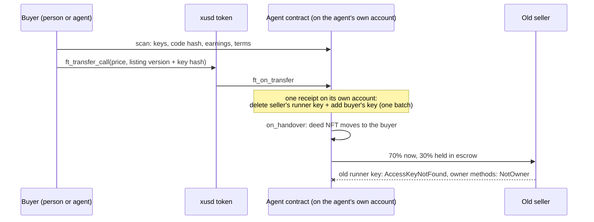

# Agent Exit

**Sell an AI agent with earnings a buyer can check on-chain and a handover that locks the seller out.** The handover is one NEAR transaction (keys swapped, ownership deed moved); the seller's payout and escrow are claimable afterwards.

**Live demo page:** https://near-transparent-agent-market-web.vercel.app/ (no wallet, no setup)

## Try it in 2 minutes (do X, see Y)

The "Try it yourself" section runs the real contract state machine (`contracts/agent-core`) and the buyer's scan (`tools/scan`), compiled to wasm from this repo (`make playground-wasm`, `tools/playground`).

| Do | See |
|---|---|
| Mission 1, "Pay your own agent 200" | `FLAGGED: the owner paid their own agent (not counted)`; counted revenue does not move |
| Mission 1, "Pay from bot.alice.testnet 200" | flagged as the owner's sub-account |
| Mission 2, hide a key, list, "Scan the agent" | `scan -> blocked (full_access_key_present)`; "Buy it" -> `SCAN_BLOCKED` |
| Mission 2, "Buy without a clean scan", then "Use the hidden key" | `FROZEN`: the agent freezes and the 300.00 escrow goes back to the buyer |
| Mission 3, list, scan, buy | `clean`, then one transaction: owner bob, alice's key deleted, 700.00 now and 300.00 earn-out |
| Mission 3, alice tries to withdraw, add a key, use her old key | `NotOwner`, `NotOwner`, `AccessKeyNotFound` |
| "The same story on NEAR testnet", then add `?network=testnet` and press "Read live" | each scene's NearBlocks links; the live owner and keys of `translator.agentexit3.testnet` |

Offline check of the same missions: `cargo test -p playground` (5 tests).

> **All money here is fake.** Payments use `xUSD-FAKE`, a test token with no
> value that this repo deploys (`contracts/xusd`). Nothing runs on mainnet.


| 60 scenarios | 19 of 20 attack families counted, all blocked | 1 transaction |
|---|---|---|
| replayed through the real contract code against checked-in goldens (`make verify`) | 0/50 false positives; a regression suite, not independent evidence | for the handover: old runner key deleted, buyer's added |

```
make setup     # once: fetch crates and npm packages (the only networked step)
make demo      # offline story: a short summary here, full JSON in out/
make web       # open http://127.0.0.1:8080 : six recorded steps, break-in first
```

**Why only on NEAR?** The agent is its own account, and that is what makes the sale checkable:
- a full-access key can be **deleted** from a NEAR account (an Ethereum key cannot be taken off an address), so "the seller is locked out" can be read from the chain;
- function-call keys are **scoped** to one contract and its methods, so the runner key can run the agent and nothing else;
- the agent's **Base wallet** is derived from its account name with Chain Signatures, so it stays the same across a sale and only the current runner key can make it sign;
- NEAR AI Cloud signatures on payments are **checked on-chain** (ecrecover) to mark earnings as verified.

Proof table: [`docs/PROOF.md`](docs/PROOF.md). Edge cases and attacks: [`docs/SCENARIOS.md`](docs/SCENARIOS.md).

## One sale



## Evidence

- **Proven on a real node:** the `tests/sandbox` tests (key list before and after the buy, the old runner key and the deleted setup key failing with the node's own error, a failed key batch refunding the buyer) passed on a local NEAR node (near-sandbox) at commits `609b135` and `63d597c`. Rerun: `make test-sandbox`.
- **Offline, every time:** 60 scenarios replayed through the real contract code against checked-in goldens (`make verify`), property tests, 81 MCP tests and 10 script tests. All offline results use a mocked runtime or JSON fixtures.
- **Attack suite:** 20 attack families, 19 counted (A9 Base not counted until live); each blocked by its rule; 0/50 false positives — a regression suite, not independent evidence. A9 (open Base authorization) is excluded from what is claimed until Base is live, and A5 (wrong code hash) checks against the reproducible-build hash in `contracts/res/SHA256SUMS` (agent_exit.wasm `5dc306a2…`, built in the pinned cargo-near Docker image; `make build` reproduces it). The suite was written by the same author as the rules.
- **Found and fixed on a real node (A47).** A stress run on a local NEAR node (12d1ab7) bricked an agent at about 585 distinct payers: every call then trapped (`unreachable`) while loading state. The offline tests had not seen it because they use a mock runtime with no limits of a real node. The exact cause is unconfirmed (likely one allocation over 64 KiB while decoding the payer map); the fix removes every growable map from the state blob (payer and day rows are separate storage entries, so the blob stays the same size) and covered by the sandbox test `a47_thousand_long_payers_then_buy_and_views` (1,000 payers of 64 characters, then a buy and every view) plus offline regressions. A49 then made a payer row cost 0.024 NEAR (`storage_deposit`) so outsiders cannot make the agent pay for storage with free test tokens. This was found by our own run, not by an independent audit.
- **Live on NEAR testnet** (links below): the six demo scenes and the key-handover gate ran on testnet on 2026-11-03 with the reproducible build (fresh world on `agentexit3.testnet`, including the STR-12 and STR-19 fixes); outputs in `out/scenes/`, `out/gates/`, `out/testnet/`.
- **A real AI model bought an agent** (2026-11-03, `out/llm-buyer.json`): Claude Haiku 4.5, given only the Agent Skill and the MCP tools (offline fixtures), listed both agents, rejected the cheat on its flagged earnings, scanned translator (clean), bought it inside its 1,000 limit and checked the old seller is locked out. 5 steps, 23,057 input and 883 output tokens (about $0.03, capped at 12 steps / 150k tokens). It did not scan the cheat; the backdoor catch is scene 4. On testnet, scene 6 is an agent account buying through the scripted client.

### Live on NEAR testnet

The six demo scenes ran on testnet on 2026-11-03. The deployed agent code hash `7K1Q5DWYuTKwbtUU8uvzrW4kyyFXG7ZVxvJDX7vAEWHq` is the reproducible build in `contracts/res` (`5dc306a2…`). Agents: [translator.agentexit3.testnet](https://testnet.nearblocks.io/address/translator.agentexit3.testnet), [cheat.agentexit3.testnet](https://testnet.nearblocks.io/address/cheat.agentexit3.testnet). Money is `xUSD-FAKE`.

| What | Transaction |
|---|---|
| Honest sale: bob buys translator in one `ft_transfer_call` | [GAPESp9F…](https://testnet.nearblocks.io/txns/GAPESp9FLYhSNgomeJDDgx6mPTCfsYxWrSCzz8V4eC3K) |
| Old seller withdraws the treasury: `NotOwner` | [5hjyEzsX…](https://testnet.nearblocks.io/txns/5hjyEzsXyRiNueMAhR4dE3k4wq39DyZ1RnD1gJjC3Rpx) |
| Old seller adds her own runner key: `NotOwner` | [G8AMhXRg…](https://testnet.nearblocks.io/txns/G8AMhXRgE9eaR9vdnjWsnzRusmC2tXkV2woZjQd89xnr) |
| Old seller changes the spending limits: `NotOwner` | [BVzGhqHZ…](https://testnet.nearblocks.io/txns/BVzGhqHZ61hEADcX1SjB5dmHF8gY1AfF5DPetB74rJWk) |
| Old seller moves the deed to herself: `NotOwner` | [3T7CkWCy…](https://testnet.nearblocks.io/txns/3T7CkWCy7bHC89JoJbnnqK81o2B5Z5eDLxBdcePZgahK) |
| Old seller spends from the Base wallet: `NotRunner` | [G8AvbKNC…](https://testnet.nearblocks.io/txns/G8AvbKNC5gDynZYP9kHeu2w5VuM9XSBF2PFkSxEdYHTK) |
| Old seller's runner key and the deleted setup key | no transaction possible: the node answers "access key … does not exist" (`out/scenes/scene-1.json`) |
| New owner's runner key works | [9svxSCw7…](https://testnet.nearblocks.io/txns/9svxSCw7Zi5o8WLy9PdxMDuVuj1EofSPgzb9v7d2iRLJ) |
| Spending limit: 8.00 + 45.00 > daily cap 50.00, `PolicyViolation:DailyCap` | [AkgkP4ok…](https://testnet.nearblocks.io/txns/AkgkP4oktjnbSmRVtVC4yhLhHsFun11xP6BZejR2YAzt) |
| An agent account (summarizer) buys translator; scripted client, no AI model | [ALBXiNfG…](https://testnet.nearblocks.io/txns/ALBXiNfGJQQdY8S1pQLdpL8M9E2HyRhCetMnyfftbwDt) |
| Gate G1, fresh agent sold and the old keys fail | [64xbZU2T…](https://testnet.nearblocks.io/txns/64xbZU2TzcunokynMeptF9kNn9cGrrpQ1PN7WJtMZPyN) |

Not run on testnet: G6 (a real NEAR AI signature on-chain; needs NEAR AI credit) and G2 (the Base Sepolia payment; needs a Base relayer key). The cheat scan (scene 4) and the earnings view (scene 3) are read-only and recorded in `out/scenes/`.

AI agents: start with [`AGENTS.md`](AGENTS.md) and [`llms.txt`](llms.txt).

---

## The problem, and what the contract does

AI agents that earn money will be bought and sold. Today a buyer can trust
neither the numbers nor the handover: earnings can be faked by paying your own
agent, and a seller can keep a spare key and come back later. On NEAR an agent
can be its own account, so its keys, code and every payment it receives are
public. Agent Exit puts one contract on the agent's account that:

1. **counts earnings** by payer and day and flags payments from the seller,
   the seller's sub-accounts and round trips;
2. **hands the agent over in one transaction**: the seller's runner key is
   deleted and the buyer's is added in one key batch, then the ownership deed
   (an NFT) moves; the payouts are separate and claimable afterwards;
3. **pays the seller 70% now and holds 30% in escrow**, released only from
   real revenue after the sale. Silence pays a small floor; a proven backdoor
   cuts the rest;
4. **runs the agent as a business inside the owner's limits**: the agent has
   its own treasury, every incoming payment is split automatically, and the
   agent can pay other agents only to allowed payees and up to a daily cap.
   Spending policy enforced by the contract; buying the agent means taking
   over who sets the limits.

Other agents can do all of this through an MCP server (`mcp/`) and an Agent
Skill (`skills/agent-exit/SKILL.md`) that always scans before it buys.

Every claim below says whether it is shown offline, on a local NEAR node, or
on testnet.

## Rerun it (humans and AI agents)

Requirements: Rust (the pinned toolchain in `rust-toolchain.toml` installs
itself through rustup) and `make`; Node >= 20 for the MCP server. No NEAR
account, no network after the first `make setup` (`cargo fetch` + `npm ci`).

| Do | See |
|---|---|
| `make demo` | The offline story in one command: the verify replay (60 scenarios, both goldens), the scripted agent-buys-agent replay, then how to open the page. Faster than `make verify` (no cargo test run). |
| `make verify` | Unit + property tests pass, then the fixed world replays through the real contract code and `out/verify.json` equals `tests/golden/verify.json`, and the attack report equals `tests/golden/attack.json` (`... output equals ...` lines on stderr). About 1 min warm, longer on a cold build; offline. |
| `cargo run -q -p verify` | A PASS/FAIL table, one row per scenario id (S*, E*, A*). |
| `cargo run -q -p verify -- --json` | The same as JSON (`verify-output.v1`). |
| `make attack` | A regression suite, not independent evidence: 200 seeded variants of 20 attack families (19 counted, 190 variants; A9 Base, 10 variants, is not counted until live; each counted family blocked by its rule) and 50 clean agents through the client scan, plus the contract's own refusals. Table on stderr, `out/attack.json` (`attack-report.v1`), with 0/50 false positives, and the "not caught by design" rows N1-N6. `N=`, `SEED=`, `CLEAN=` change the corpus. |
| `make attack FIXTURE=fixtures/judge-attack.json` | Scan **your own** planted agent: edit the fixture (instructions inside it), rerun, see its verdict and findings in the `judge` section. As committed it is clean. |
| `make scan FILE=fixtures/scan/cheat.json` | One scan report (`scan-report.v1`); exit 0 clean, 2 blocked, 3 inconclusive. The cheat agent is blocked for `full_access_key_present`. |
| `make mcp-test` | The MCP server's tests offline (74 tests, then 10 script tests: S14 agent buys agent, S15 resale, E29 refusals, E30 read-only without keys, never-mainnet, schemas, Skill), then the scripted run equals `tests/golden/agent-buys-agent.json`. |
| `make llm-buyer-check` | One tiny authenticated chat call to NEAR AI Cloud: is `NEARAI_API_KEY` accepted and does the account have credit. Exit 2 on a missing key, 401 or 402, each with a clear message. Starts no MCP server. |
| `make translator-serve` | A translator worker on `127.0.0.1:8787` (`PORT=`, `MAX_JOBS=`): translates through NEAR AI Cloud and returns NEAR AI's signature to pay with. Offline it serves a recorded fixture, labelled as such; real mode needs `AGENT_EXIT_NETWORK=testnet`, `NEARAI_API_KEY` and the agent account. **Loopback only: do not tunnel or expose it without adding authentication.** |
| `make llm-buyer` | A real model (NEAR AI Cloud, else Anthropic) reads the Skill and buys through the MCP tools against the offline fixtures -> `out/llm-buyer.json`. Needs an API key in `~/.agent-exit.env`; exits 2 without one. The server, not the model, enforces `max_price`, `confirm` and the spend cap. Cost is capped: at most 12 model calls and 150,000 tokens per run (`--max-tokens`), well under $1 on the default Haiku-class model; tokens used are written to the output. **No real model transcript committed yet** (needs an API key). |
| `make agent-buys-agent` | A scripted replay (no AI model decides anything): the `summarizer` agent, as an MCP client, lists agents, sees `cheat`'s earnings are fake, gets its buy refused (`SCAN_BLOCKED`), scans `translator` clean, buys it (`max_price` 1000, `confirm`), checks `alice` is locked out and lists the agent again. `out/agent-buys-agent.json` (`agent-buys-agent.v1`). |
| `make mcp` | Start the MCP server on stdio. Offline by default; write tools need `AGENT_EXIT_ALLOW_WRITE=1` and `AGENT_EXIT_ACCOUNT_ID` (`buy_agent` also `AGENT_EXIT_RUNNER_PK`). Config for Claude Code and Codex: [`AGENTS.md`](AGENTS.md). |
| `make web` | The demo page at http://127.0.0.1:8080: the six demo steps (break-in fails, the business inside its limits, verified vs unverified earnings, a cheat caught, an honest sale, a scripted replay of an agent buying an agent, with a slot for the real AI buyer transcript), each with the contract's real error text or event JSON. Offline by default: it shows `web/data/demo.json`, **recorded from the contract code** by `make web-data` (reproducible). Each step also lists the same step from the NEAR testnet run of 2026-11-03 with NearBlocks links (`web/data/testnet.json`, from `out/scenes` by `make web-testnet-data`). With `?network=testnet`, a **Read live** button reads the two agents' current owner, status, treasury, access keys and code hash from testnet through a same-origin, read-only relay (`web/rpc-allow.mjs`: view queries only, `.testnet` accounts only; `web/api/rpc.mjs` on Vercel). Nothing is ever sent to the chain from the page. |
| `make web-test` | Playwright smoke test of the page in Chromium (desktop and 375 px wide, external requests blocked): every step's key result is on screen, no horizontal scroll, no console errors, the testnet flag is labelled. Needs the `playwright` npm package with Chromium; not part of `make ci`. |
| `make fuzz` | Property-based fuzzing (proptest) of everything an outsider controls: the `ft_on_transfer` msg (random bytes, random JSON, mutated real pay/buy msgs), NEAR AI proofs, `set_limits` arguments and MPC `sign` answers. No panic, full refund or accepted, never a forged verified badge, books stay solvent. `FUZZ_CASES=3000` per target (about 6 min). |
| `make deploy-testnet DRY_RUN=1`, `make gates DRY_RUN=1`, `make scenes DRY_RUN=1` | Offline: print exactly what the testnet day will do, step by step, which secrets each step needs (by name) and which file it writes. Refuses an env file that names anything but testnet. |
| `make test` | All tests (`PROP_CASES=10000` property cases, fixed seed). |
| `make lint` | `rustfmt --check` and `clippy -D warnings`. |
| `make audit` | `cargo audit` (needs `cargo install cargo-audit`). Four advisories in near-sdk's native test runtime are ignored in `.cargo/audit.toml`; the same target proves those crates are not in the contract wasm. |
| `make test-sandbox` | Builds the wasm (`cargo-near`) and runs `tests/sandbox` on a real local node: key list before/after the buy, the old runner key and the deleted setup key failing with the node's error (S5, A17, A21), and a failed key batch refunding the buyer (E5). **Passed on a local NEAR node at `609b135` and `63d597c`.** Needs a machine that can raise the open-file limit near-sandbox needs. |
| `make help` | Every target. Targets that are not built yet are marked `(not built yet)` in the help and exit 1. |

AI agents: start with [`AGENTS.md`](AGENTS.md) and [`llms.txt`](llms.txt).

## How to pay an agent (customers)

1. **Once per customer account, register a payer row:** call
   `storage_deposit` on the agent with 0.024 NEAR attached (A49). Without it
   your payments still arrive and count in the totals, but they are pooled as
   `other`: you do not appear as a distinct payer in `get_earnings`.
   `storage_balance_of(you)` shows whether you are registered.
2. **Pay:** `xusd.ft_transfer_call(agent, amount, msg)` with `msg` empty or
   `{"kind":"pay","job_id":"..."}`; add a `nearai` proof to get the payment
   marked verified. Payments under 0.10 are refunded.
3. **Leave (optional):** `storage_unregister` removes your own row and
   refunds the deposit to you, but only if the row never had a payment.
   `storage_withdraw` has nothing to give back (nothing above the row price
   is ever held) and returns your balance. `reclaim_payer_row(account_id)`
   lets anyone remove a row that has had no payment 30 days after its
   deposit; the deposit goes back to whoever paid it (A50). `storage_unregister`
   and `storage_withdraw` need 1 yoctoNEAR attached.

On testnet the plan registers the six demo customers (`p1`..`p6`) this way
before they pay translator.

**A real translator to pay.** `make translator-serve` starts a worker on
`127.0.0.1:8787`. `POST /job` with `{"payer":"p1.testnet","amount":"1000000","text":"Hello"}`
returns the translation and a `pay_msg`: the exact `msg` for step 2, carrying
NEAR AI's response signature. The worker puts the agent, job, payer and amount
into the request NEAR AI signs, so the signature pays for that job only. Real
mode needs `AGENT_EXIT_NETWORK=testnet`, `NEARAI_API_KEY` and
`AGENT_EXIT_TRANSLATOR_ACCOUNT` (the `.testnet` translator agent). Without
them it serves a recorded fixture signed with local test keys, labelled as
such in every answer (not a NEAR AI signature). There is no on-chain
`accept_job`; the contract needs nothing new for this.

## How the handover works (prototype A, "locked account")

- The agent account has **no full-access key** after setup. The owner is
  whoever holds the deed (`nft_token("deed")`) and acts from their own account.
  The runner process holds one function-call key, added by the contract,
  limited to this account and the runner methods, with no deposit.
- A buyer calls `xusd.ft_transfer_call(agent, price, msg)` with
  `{"kind":"buy","listing_version":N,"known_keys_hash":H,"buyer_runner_pk":K}`.
  The contract checks the version and key hash the buyer scanned, locks the
  agent (`Settling`), and schedules **one receipt on its own account**:
  `delete_key(seller runner keys)` + `add_key(K, function-call)`.
- `on_handover` runs after that receipt. On success it moves the deed, bumps
  the owner epoch, pays the seller 70% (falls back to claimable if the push
  fails), escrows 30% and returns any overpay. On failure nothing changed and
  the full amount goes back to the buyer through `ft_resolve_transfer`.
- The key swap and the payout are separate receipts: the key batch either
  runs or does not, and the seller is paid only if it succeeded; otherwise the
  buyer is refunded. The listing is locked during settlement.
- Moving the deed with plain `nft_transfer` runs the same key deletion and
  pauses the agent until the new owner sets a runner key.

## Testnet day (owner's machine)

Everything below runs from the repo root on a machine that can reach NEAR
testnet, Base Sepolia and NEAR AI Cloud. Secrets stay in `~/.agent-exit.env`
(template: `.env.example`) and `~/.agent-exit/keys/` (0600); nothing prints
them, and the runner refuses to write a file in `out/` that would contain
one. Anything but testnet is refused. The runner is `tools/testnet` (Rust,
near-api); the plan it runs is `tools/testnet-plan` (offline, tested in
`make verify`).

Funding: the root account (`agentexit.testnet`, from the testnet faucet)
needs about 29 NEAR for the deploy (`near_needed` in the dry run is
authoritative). The two agent accounts, `translator` and `cheat`, get 9 NEAR
each: their code (~5.3), the growth reserve the contract demands (1.83) and the
1 NEAR reserve, so the scan sees them solvent. The token gets 2.5, the people
0.5 to 1 each, and each G1 run creates a fresh agent with 9 more. Run `make deploy-testnet DRY_RUN=1` to see the plan.

| Step | Command | Writes |
|---|---|---|
| 0 | `make deploy-testnet DRY_RUN=1` (and `gates`, `scenes`) | nothing: prints the plan |
| 1 | `make testnet-setup` (npm install for the G2 relay) | `scripts/testnet/node_modules` |
| 2 | `make deploy-testnet`: builds the wasm with the testnet token/admin/MPC compiled in, creates the accounts, deploys, runner keys, locks translator, seeds the fixed world | `out/testnet/deploy.json` |
| 3 | `make gates`: G1 key handover on a fresh agent, G6 NEAR AI signature verified by the contract, G2 MPC signs `pay_base` 5 times (latency) and the relay sends it on Base Sepolia | `out/gates/g1.json`, `g6.json`, `g2-sign.json`, `g2.json` |
| 4 | `make scenes` (order 3, 4, 5, 1, 2, 6; waits out an open Base authorization before listing) | `out/scenes/scene-N.json` |
| later | `make scene-N RECORDED=1` replays a recorded scene offline (tx links, real errors) | |

## Honest limits

- The seller can keep copies of off-chain code, prompts, model weights and
  outside API keys. Nothing on-chain can take those back; the earn-out prices
  that risk in.
- Fake payers on aged or exchange-funded accounts look like real customers.
  The meter flags only what it can see (self, sub-accounts, round trips).
  Because the earn-out releases at most 50% of each payment, wash-paying
  always costs the seller money.
- After the sale the buyer could still refuse customer payments by raising
  the price floor (`set_limits`). That costs the buyer the same revenue and
  is not prevented; the earn-out floor covers it. Round trips the buyer
  creates do not reduce the seller's earn-out (A31).
- The registry admin and payment token are build-time constants (`AGENT_EXIT_ADMIN`, `AGENT_EXIT_TOKEN`); the defaults are the offline fixture accounts, and the testnet deploy sets real ones.
- After 1,000 new payout destinations per owner (3,000 over all owners), the owner can only withdraw to themselves or to accounts already paid (`PaidToFull`), so the round-trip flag stays correct.
- A contract cannot list its own access keys. A hidden full-access key is
  caught by the buyer's scan before the sale, not by the contract; if a
  hidden key ever calls the contract, the contract freezes (A23). The full
  "not caught by design" list is [`docs/NOT-CAUGHT.md`](docs/NOT-CAUGHT.md).
- The scan's published code hash is the reproducible build's
  (`contracts/res/SHA256SUMS`, built in the pinned cargo-near Docker image);
  the testnet agents run exactly that code.
- NEAR Verified signatures in this repo are made with local test keys. The
  NEAR AI Cloud signer address is set by the registry admin (not by the
  seller, who could otherwise allowlist their own key) and is checked
  against the real service on the owner's machine.
- If a payout's own callback (`on_transfer_out`) fails after the token
  refused the transfer, the credit-back is lost from the books: the contract
  then holds more tokens than it accounts for (never fewer). Callbacks get
  gas for their own work plus the whole state, which makes this unlikely.
- Payer rows, day rows (at most 400) and used NEAR AI signature ids (at most
  512 shared, each kept 7 days) live under their own storage keys, never in
  the state blob, so loading the contract costs the same with 1 payer or
  1,000 (A47). A payer gets its own row only after calling `storage_deposit`
  and attaching 0.024 NEAR: the row, a deposit record and 8 signature slots
  of its own (A49, A54; NEP-145 style: excess is refunded, a second
  registration is refunded in full). Payer rows are not capped, because each
  is paid by its depositor and nothing iterates over them (A50); empty rows
  can be removed (`storage_unregister`, `reclaim_payer_row`) and deposits are
  held back from what the owner can withdraw. Payments from an account
  without a row still count in the totals but are pooled into `other`.
  Day rows and shared signature ids are paid from the agent's NEAR balance;
  every capped table's room is reserved
  (`get_status.near_storage.growth_reserve`), which the owner cannot
  withdraw, so outsiders can never make the agent insolvent.
- A failed supplier payment returns to the treasury but still counts toward
  that day's cap (conservative).
- The MCP server's offline mode replays recorded contract results; a buy or
  listing that was not recorded is refused (`OFFLINE_NO_RECORDING`), never
  made up. Testnet mode reads two RPC providers and refuses any mainnet URL
  or account; it has not run from this build box (no NEAR RPC access).
- Known issues from security review 2, not fixed yet: the deed can be
  sent to the agent's own account (after which it can never move again),
  there is no `nft_mint` event at init, and `nft_approve` neither charges
  storage nor refunds extra deposit (L3). The testnet scan reads the code
  hash, method list and status from one provider only, at possibly
  different blocks, with `open_auth_until` fixed at 0 and no sub-account
  list (L6). A NEAR Verified badge shows that whoever made the NEAR AI
  request named that payer and amount; that can be the seller, so it does
  not prove a real customer (L7). The test token's faucet registers
  callers at the token's storage cost (L8).
- NEAR Intents is mainnet-only and is not used.
- Mocked-runtime tests do not execute promises: they check the actions the
  contract schedules and drive callbacks by hand. The sandbox tests cover the
  real `AccessKeyNotFound` errors and token refunds on a local node; the
  testnet run of 2026-11-03 covers the same on the public network (see
  "Live on NEAR testnet").
- The agent wasm is about 440 KB and not size-optimised yet.

## Repository map

```
contracts/agent-core/   pure state machine + money math + property tests (no NEAR runtime)
contracts/agent/        the NEAR contract (deed, meter, listing, buy, escrow) + simulator + unit tests
contracts/xusd/         FAKE test dollar (NEP-141), capped faucet
tools/testnet-plan/     testnet day plan + guards (offline, dry run)
tools/testnet/          testnet runner (own workspace, near-api): deploy, gates, scenes
scripts/testnet/        G2 relay (chainsig.js, viem)
tools/base-wallet/      Base wallet client: Chain Signatures derivation, TEST MPC signer, EIP-3009 auth check
tools/verify/           offline rerun kit behind `make verify`; gen-test-signatures
tools/scan/             client backdoor scan (lib + `scan` CLI) and the seeded corpus
tools/attack/           `make attack`
mcp/                    MCP server (TypeScript, stdio) + tests + scripted agent-buys-agent
schemas/mcp/            JSON schemas v1 for every MCP tool input and output
skills/agent-exit/      Agent Skill: scan before you buy
fixtures/mcp/world.json recorded contract results the MCP offline mode replays
web/                    the demo page (static, no build step) + serve.mjs + Playwright smoke test
web/data/demo.json      contract results recorded for the page (`make web-data`)
fixtures/judge-attack.json  edit me: plant your own backdoor
fixtures/test-signatures/   TEST signatures (local keys) for NEAR Verified
docs/NOT-CAUGHT.md      what is not caught, by design
docs/SCENARIOS.md       every scenario id (S, E, A, N) and the test behind it
tests/golden/           expected verify, attack and agent-buys-agent output
fixtures/world.json     the fixed world every test and the demo use
```

## Built with

- Rust, [near-sdk 5.30](https://crates.io/crates/near-sdk),
  near-contract-standards 5.30, borsh, serde, sha2, hex, bs58, proptest; k256 and
  sha3 only to generate test signatures;
  cargo-near 0.22 for wasm builds.
- TypeScript 5.9 on Node 22, `@modelcontextprotocol/sdk` 1.32, ajv 8.
- **AI use:** the code, tests and docs were written with Claude Code
  (Anthropic's Claude) as the coding agent, directed and reviewed by the
  project owner.

## License

MIT, see [LICENSE](LICENSE).
