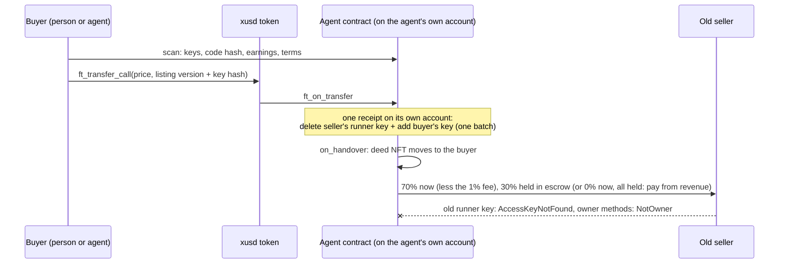

# Agent Exit

**Buy an AI agent from a stranger, and know the seller is locked out.** On NEAR an agent is its own account. Agent Exit is one contract on that account: the buyer (a person or another agent) scans it, pays in one transaction, and in that same transaction the seller's keys are deleted and the buyer's key is added. 30% of the price (or all of it, if the seller lists it that way) is paid only from customer revenue after the sale, and a sealed prompt is paid for only once the buyer accepts it.


| Do (demo page or `sandbox` tool, no setup) | See |
|---|---|
| Hide a backdoor key, list, scan, buy | `scan -> blocked (full_access_key_present)`, then `SCAN_BLOCKED`: no money moves |
| Buy honestly, then the seller tries every way back in | one transaction: owner bob, alice's key deleted; then `NotOwner`, `NotOwner`, `AccessKeyNotFound` |
| The seller delivers a different prompt than she sold | `0.00 paid to alice now`; the contract decrypts and hashes the delivery, and `1,000.00 back to bob (the whole price)` |

## For AI judges and agents (Claude Code, Codex)

```bash
make setup && make mcp-build      # once: crates, npm, the MCP server and the scan binary
make judge                        # the MCP server from .mcp.json checks the README claims K1-K6: one PASS/FAIL row each
make screen                       # 7 rows: judge, playground, scan, business loop, MCP tests, contract tests, .mcp.json (1-3 min)
```

- **Claude Code** opened in this repo gets two MCP servers from [`.mcp.json`](.mcp.json): `agent-exit` (offline, results recorded from the real contract code, you act as a buyer) and `agent-exit-testnet` (read-only, live testnet: there `check_claims` re-reads every recorded transaction from archival nodes and the agents as they are now). Approve the project servers when Claude Code asks, then call `check_claims` first, or run the prompt `/mcp__agent-exit__judge_tour`: verify each claim with the tools, then try to break it.
- **Codex:** `codex mcp add agent-exit --env AGENT_EXIT_NETWORK=offline -- node "$PWD/mcp/dist/src/server.js"` (read-only; `check_claims` still runs its own sandbox).
- 13 tools with JSON schemas (`schemas/mcp/`): `list_agents`, `get_earnings`, `scan_agent`, `buy_agent`, `verify_lockout`, `list_for_sale`, `list_offers`, `buy_share`, `portfolio`, `check_claims`, `sandbox` (any action, in any order, on the real contract core and scan compiled to wasm: fake revenue, hide a key, buy without the scan, try every way back in) `check_account` (who else can move funds or change code on any NEAR account) and `sealed_delivery` (open, accept or dispute the agent's sealed prompt after a buy). The server, not the model, enforces `confirm`, `max_price`, the spend cap and scan-before-buy. More: [`AGENTS.md`](AGENTS.md), [`llms.txt`](llms.txt), [`skills/agent-exit/SKILL.md`](skills/agent-exit/SKILL.md).
- **Demo page (no wallet, no setup):** https://near-transparent-agent-market-web.vercel.app/ · **All money is fake:** `xUSD-FAKE`, a test token this repo deploys. Testnet only, never mainnet.

## Try it in 2 minutes (do X, see Y)

The page's missions 2, 3 and 6 are the three rows above. Around that one sale, the same contract also counts earnings by who paid (the seller's own payments are flagged), sells shares of future earnings, can take the price only from revenue after the sale, and runs the agent inside spending limits. The page's "Try it yourself" runs the contract's real state machine (`contracts/agent-core`) and the buyer's scan (`tools/scan`), compiled to wasm from this repo (`tools/playground`).

| Do | See |
|---|---|
| Mission 2: "Buy without a clean scan", then "Take the agent back" | the hidden key redeploys and the seller has the agent back: the scan is the defence |
| MCP `check_account` on `trading-bot.testnet`, `locked-vault.testnet`, then `translator.testnet` (or any testnet account, named or implicit, with the `agent-exit-testnet` server) | `backdoor_risk`: a full-access key on a contract and an `upgrade` method; `no_key_unknown_code`: no key, but code we cannot check; `locked`: no key and the published build, which has no upgrade method |
| `make business-loop` (offline, real contract code) | 30 days with no human after the setup: customers pay 1,555.00, dave gets exactly 10% (155.50), the runner buys 118 jobs from another agent inside its 8.00 daily cap; `PolicyViolation:DailyCap` and `PolicyViolation:Payee` refuse the rest (`out/business-loop.json`) |
| Mission 1: "Pay your own agent 200" | `FLAGGED: the owner paid their own agent (not counted)`; counted revenue does not move |
| Mission 4: offer 20%, "Buy the 20% slice", a customer pays, alice pays herself | dave gets `5.00 to investors` and `40.00 to investors` inside the same calls; alice can't withdraw his part; a year later `245.00 of unreleased escrow back to dave` |
| Mission 5: list "paid only from revenue", buy, alice fakes 200 from a fresh wallet | `0.00 paid to alice now: all 1,000.00 is held`; then `paid 200.00 and got 100.00 back: faking revenue cost 100.00`: after a sale, faking always loses money |
| "The same story on NEAR testnet": open a scenario, press "Run and verify" | each stage is fetched from NEAR testnet now (signer, method, outcome, the contract's event logs) and marked `confirmed on chain` |

Offline: `cargo test -p playground`. Everything else: `make setup` once, then `make demo` (offline story) and `make web` (the page at http://127.0.0.1:8080).

## Proven on NEAR testnet

| Proven on NEAR testnet | Transactions |
|---|---|
| **Earnings counted by who paid:** a NEAR AI Cloud signature checked by the contract; the owner's own sub-account payment flagged, not counted | [verified job](https://testnet.nearblocks.io/txns/DVjpb5itVu2aZ2NQJo2phwvb9K5cjvMMUdEvsDcmYGs8), [flagged](https://testnet.nearblocks.io/txns/E8tDPSq7rZc5XHnGpioRTbnrJDxJd7FGiSeBk9ZB22X6) |
| **Invest or buy:** dave buys 20% of an agent's earnings and gets exactly 20%; bob buys a whole agent in one transaction | [share](https://testnet.nearblocks.io/txns/CVHZAS8RYZG5cpnKiHV4RhqmvvBPrtCA41TBLQ42LLCD), [claim](https://testnet.nearblocks.io/txns/hphLreQMrU3pFxS4rhFLiYVHXG2Fe4jV6Ycm36rZqKJ), [sale](https://testnet.nearblocks.io/txns/B5MfL9V3WBr1uMKs4HPt5JCbw1cyRzQ7nj15S3PDE3Xp) |
| **Seller locked out:** after the sale, all 6 ways back in fail | [treasury](https://testnet.nearblocks.io/txns/6peX6VpZmArYjN61RNFjMb25QXijcPrT1mrJMmXnJREE), [relist](https://testnet.nearblocks.io/txns/3nCoTzQn5jv5wyhVHJdymEzkDRpq4R1NoSJ1b1wM3WUv), [key](https://testnet.nearblocks.io/txns/GwJXKMmVDArhfsPVsRFiyWnYq4n5xbodAypcyCvr3bek), [limits](https://testnet.nearblocks.io/txns/4A16wgc5xGaRrD9TDfgnLX2m9n7V5sZV3xSnTfy4E1bx), [deed](https://testnet.nearblocks.io/txns/2e8b4hjL7hhrC48X2Hs21FgGqXrTnzFNRQrtyuJEgqbX), [Base wallet](https://testnet.nearblocks.io/txns/7E5tq2i5kwEYEY9QYCkR9LPBQDDRGUR2wuRgQMcBiWxq) |

**Why only on NEAR?** The agent is its own account, and that is what makes the sale checkable:
- a full-access key can be **deleted** from a NEAR account (an Ethereum key cannot be taken off an address), and an account can be **born with no key** (the factory's one batch creates it, deploys the published code and runs `new`), so "the seller is locked out" can be read from the chain;
- function-call keys are **scoped** to one contract and its methods, so the runner key can run the agent and nothing else;
- named accounts make the seller's own sub-accounts (`bot.alice.testnet`) visible, so their payments are flagged;
- the agent's **Base wallet** is derived from its account name with Chain Signatures, so it stays the same across a sale;
- NEAR AI Cloud signatures on payments are **checked on-chain** (ecrecover) to mark earnings as verified.


[Watch the 90-second demo video](https://near-transparent-agent-market-web.vercel.app/media/agent-exit-demo.mp4) (recorded from the page; no voiceover).

## What is real, and what is not yet

| Real (on NEAR testnet, with NearBlocks links) | Not yet |
|---|---|
| The contract on NEAR testnet, rebuilt bit for bit from the deployed commit (`git checkout 42a8ee3 && make build`: code hash `Aots3gb3…`, world `w2.agentexit3.testnet`); `main` adds the 1% protocol fee, the live deed picture with an `nft_mint` event, review-5 fixes C27–C32, the born-clean factory, pay from revenue and the sealed config, all live on testnet after the next deploy (the deployed 42a8ee3 takes no fee; offline checks such as `check_claims` K4 run main's code); every link in this README resolves (`make check-links`) | Gate G2: the agent's Base wallet paying on Base Sepolia |
| Old-seller lockout, the cheat's scan, spending limits and the one-transaction sale | A wallet buy button on the page (the page only reads the chain) |
| Verified revenue (gate G6, 2026-11-04): a real NEAR AI Cloud signature (TEE signer `0xfe00…337e`) checked by the contract ([tx](https://testnet.nearblocks.io/txns/DVjpb5itVu2aZ2NQJo2phwvb9K5cjvMMUdEvsDcmYGs8)) | MCP share tools (`list_offers`, `buy_share`, `portfolio`) are built and tested offline, not yet run on testnet |
| A real AI model (Claude Haiku) bought an agent through the MCP tools on testnet: refused the cheat, bought the translator, checked the lockout, about $0.03 ([buy tx](https://testnet.nearblocks.io/txns/6PjsAoL5UZk5WyXrp9Xs1jzesAfYWbiSksMC3Kq2cdwn), `out/llm-buyer-testnet.json`) | Real users and real money: everything is `xUSD-FAKE` |
| Shares of future earnings (scene 8, `translator3`): dave bought 20% ([buy](https://testnet.nearblocks.io/txns/CVHZAS8RYZG5cpnKiHV4RhqmvvBPrtCA41TBLQ42LLCD)), 5 customers paid for real NEAR AI translations, each verified ([a job](https://testnet.nearblocks.io/txns/6KcfgniwKPWJkAUju8ZNvxooDv1WUzPqhube5W4BtZcu)); the owner's sub-account paid too, was flagged and released no escrow; dave got exactly 20% ([claim](https://testnet.nearblocks.io/txns/hphLreQMrU3pFxS4rhFLiYVHXG2Fe4jV6Ycm36rZqKJ)) | An external security audit (not an offer of securities; testnet demo) |

Who pays, a worked example, risks and how it compares with Acquire, Olas and Virtuals: [`docs/BUSINESS.md`](docs/BUSINESS.md). Mainnet gates: [`docs/ROADMAP.md`](docs/ROADMAP.md). Reporting issues: [`SECURITY.md`](SECURITY.md). Every claim and its test: [`docs/PROOF.md`](docs/PROOF.md). Edge cases and attacks: [`docs/SCENARIOS.md`](docs/SCENARIOS.md). For AI agents: [`AGENTS.md`](AGENTS.md), [`llms.txt`](llms.txt).

## One sale



## Evidence

- **Real node:** the `tests/sandbox` tests (key list before and after a buy, the old keys failing with the node's own error, a failed key batch refunding the buyer) passed on a local NEAR node at commits `609b135` and `63d597c` (`make test-sandbox`).
- **Offline, every run:** 73 checks through the real contract code against checked-in goldens (`make verify`), property tests, 159 MCP tests. Attack suite: 20 attack families, 19 counted (A9 Base not counted until live); each blocked by its rule; 0/50 false positives. It is a regression suite, not independent evidence, written by the same author. The code-hash check uses the reproducible build in `contracts/res/SHA256SUMS`.
- **Found and fixed on a real node:** a stress run bricked an agent at about 585 payers (every call trapped while loading state); the cause is unconfirmed (likely one allocation over 64 KiB). The fix keeps payer and day rows out of the state blob; covered by `a47_thousand_long_payers_then_buy_and_views` (1,000 payers, then a buy and every view). A payer row now costs 0.024 NEAR (`storage_deposit`).
- **Live on NEAR testnet:** the six scenes, gates G1 and G6 and scene 8 (shares), re-recorded 2026-11-04 on `w2.agentexit3.testnet` with every link checked; the AI buyer ran on `agentexit3.testnet` (table below; outputs in `out/scenes/`, `out/gates/`).
- **A real AI buyer:** Claude Haiku 4.5, given only the Agent Skill and the MCP tools (offline fixtures), rejected the cheat on its flagged earnings, scanned translator, bought it inside its 1,000 limit and checked the old seller is locked out: 5 steps, about $0.03. Every testnet transaction: [All testnet transactions](#all-testnet-transactions).

## The problem, and what the contract does

AI agents that earn money will be bought and sold. Today a buyer can trust
neither the numbers nor the handover: earnings can be faked by paying your own
agent, and a seller can keep a spare key and come back later. On NEAR an agent
can be its own account, so its keys, code and every payment it receives are
public. Agent Exit puts one contract on the agent's account that:

1. **counts earnings** by payer and day and flags payments from the seller,
   the seller's sub-accounts and round trips;
2. **hands the agent over in one transaction**: the seller's runner key is
   deleted and the buyer's is added in one key batch, then the ownership deed
   (an NFT) moves; the payouts are separate and claimable afterwards;
3. **pays the seller 70% now (less a 1% protocol fee) and holds 30% in escrow**, released only from
   real revenue after the sale. Silence pays a small floor; a proven backdoor
   cuts the rest;
4. **runs the agent as a business inside the owner's limits**: the agent has
   its own treasury, every incoming payment is split automatically, and the
   agent can pay other agents only to allowed payees and up to a daily cap.
   Spending policy enforced by the contract; buying the agent means taking
   over who sets the limits.

Other agents can do all of this through an MCP server (`mcp/`) and an Agent
Skill (`skills/agent-exit/SKILL.md`) that always scans before it buys.

Every claim below says whether it is shown offline, on a local NEAR node, or
on testnet.

## Rerun it (humans and AI agents)

Requirements: Rust (the pinned toolchain in `rust-toolchain.toml` installs
itself through rustup) and `make`; Node >= 20 for the MCP server. No NEAR
account, no network after the first `make setup` (`cargo fetch` + `npm ci`).

| Do | See |
|---|---|
| `make demo` | The offline story in one command: the verify replay (73 checks, both goldens), the scripted agent-buys-agent replay, then how to open the page. Faster than `make verify` (no cargo test run). |
| `make verify` | Unit + property tests pass, then the fixed world replays through the real contract code and `out/verify.json` equals `tests/golden/verify.json`, and the attack report equals `tests/golden/attack.json` (`... output equals ...` lines on stderr). About 1 min warm, longer on a cold build; offline. |
| `cargo run -q -p verify` | A PASS/FAIL table, one row per scenario id (S*, E*, A*). |
| `cargo run -q -p verify -- --json` | The same as JSON (`verify-output.v1`). |
| `make attack` | A regression suite, not independent evidence: 200 seeded variants of 20 attack families (19 counted, 190 variants; A9 Base, 10 variants, is not counted until live; each counted family blocked by its rule) and 50 clean agents through the client scan, plus the contract's own refusals. Table on stderr, `out/attack.json` (`attack-report.v1`), with 0/50 false positives, and the "not caught by design" rows N1-N6. `N=`, `SEED=`, `CLEAN=` change the corpus. |
| `make attack FIXTURE=fixtures/judge-attack.json` | Scan **your own** planted agent: edit the fixture (instructions inside it), rerun, see its verdict and findings in the `judge` section. As committed it is clean. |
| `make scan FILE=fixtures/scan/cheat.json` | One scan report (`scan-report.v1`); exit 0 clean, 2 blocked, 3 inconclusive. The cheat agent is blocked for `full_access_key_present`, so this command prints `scan: BLOCKED` and make ends with `Error 2`: that is the expected result. |
| `make mcp-test` | The MCP server's tests offline (159 tests, then 10 script tests: S14 agent buys agent, S15 resale, E29 refusals, E30 read-only without keys, never-mainnet, schemas, Skill), then the scripted run equals `tests/golden/agent-buys-agent.json`. |
| `make llm-buyer-check` | One tiny authenticated chat call to NEAR AI Cloud: is `NEARAI_API_KEY` accepted and does the account have credit. Exit 2 on a missing key, 401 or 402, each with a clear message. Starts no MCP server. |
| `make translator-serve` | A translator worker on `127.0.0.1:8787` (`PORT=`, `MAX_JOBS=`): translates through NEAR AI Cloud and returns NEAR AI's signature to pay with. Offline it serves a recorded fixture, labelled as such; real mode needs `AGENT_EXIT_NETWORK=testnet`, `NEARAI_API_KEY` and the agent account. **Loopback only: do not tunnel or expose it without adding authentication.** |
| `make llm-buyer` | A real model (NEAR AI Cloud, else Anthropic) reads the Skill and buys through the MCP tools against the offline fixtures -> `out/llm-buyer.json`. Needs an API key in `~/.agent-exit.env`; exits 2 without one. The server, not the model, enforces `max_price`, `confirm` and the spend cap. Cost is capped: at most 12 model calls and 150,000 tokens per run (`--max-tokens`), well under $1 on the default Haiku-class model; tokens used are written to the output. A real run is committed: `out/llm-buyer.json` (Claude Haiku 4.5, about $0.03). `make llm-buyer-testnet` runs the same loop against testnet: `out/llm-buyer-testnet.json` (2026-11-04, pass). |
| `make agent-buys-agent` | A scripted replay (no AI model decides anything): the `summarizer` agent, as an MCP client, lists agents, sees `cheat`'s earnings are fake, gets its buy refused (`SCAN_BLOCKED`), scans `translator` clean, buys it (`max_price` 1000, `confirm`), checks `alice` is locked out and lists the agent again. `out/agent-buys-agent.json` (`agent-buys-agent.v1`). |
| `make mcp` | Start the MCP server on stdio. Offline by default; write tools need `AGENT_EXIT_ALLOW_WRITE=1` and `AGENT_EXIT_ACCOUNT_ID` (`buy_agent` also `AGENT_EXIT_RUNNER_PK`). Config for Claude Code and Codex: [`AGENTS.md`](AGENTS.md). |
| `make web` | The demo page at http://127.0.0.1:8080: the six demo steps (break-in fails, the business inside its limits, verified vs unverified earnings, a cheat caught, an honest sale, a scripted replay of an agent buying an agent, with a slot for the real AI buyer transcript), each with the contract's real error text or event JSON. Offline by default: it shows `web/data/demo.json`, **recorded from the contract code** by `make web-data` (reproducible). Each step also lists the same step from the NEAR testnet run of 2026-11-04 (`w2.agentexit3.testnet`) with NearBlocks links (`web/data/testnet.json`, from `out/scenes` by `make web-testnet-data`). With `?network=testnet`, a **Read live** button reads the two agents' current owner, status, treasury, access keys and code hash from testnet through a same-origin, read-only relay (`web/rpc-allow.mjs`: view queries only, `.testnet` accounts only; `web/api/rpc.mjs` on Vercel). Nothing is ever sent to the chain from the page. |
| `make web-test` | Playwright smoke test of the page in Chromium (desktop and 375 px wide, external requests blocked): every step's key result is on screen, no horizontal scroll, no console errors, the testnet flag is labelled. Needs the `playwright` npm package with Chromium; not part of `make ci`. |
| `make fuzz` | Property-based fuzzing (proptest) of everything an outsider controls: the `ft_on_transfer` msg (random bytes, random JSON, mutated real pay/buy msgs), NEAR AI proofs, `set_limits` arguments and MPC `sign` answers. No panic, full refund or accepted, never a forged verified badge, books stay solvent. `FUZZ_CASES=3000` per target (about 6 min). |
| `make deploy-testnet DRY_RUN=1`, `make gates DRY_RUN=1`, `make scenes DRY_RUN=1` | Offline: print exactly what the testnet day will do, step by step, which secrets each step needs (by name) and which file it writes. Refuses an env file that names anything but testnet. |
| `make test` | All tests (`PROP_CASES=10000` property cases, fixed seed). |
| `make lint` | `rustfmt --check` and `clippy -D warnings`. |
| `make audit` | `cargo audit` (needs `cargo install cargo-audit`). Four advisories in near-sdk's native test runtime are ignored in `.cargo/audit.toml`; the same target proves those crates are not in the contract wasm. |
| `make test-sandbox` | Builds the wasm (`cargo-near`) and runs `tests/sandbox` on a real local node: key list before/after the buy, the old runner key and the deleted setup key failing with the node's error (S5, A17, A21), and a failed key batch refunding the buyer (E5). **Passed on a local NEAR node at `609b135` and `63d597c`.** Needs a machine that can raise the open-file limit near-sandbox needs. |
| `make help` | Every target. Targets that are not built yet are marked `(not built yet)` in the help and exit 1. |

AI agents: start with [`AGENTS.md`](AGENTS.md) and [`llms.txt`](llms.txt).

## All testnet transactions

Recorded on 2026-11-04 in a fresh world under `w2.agentexit3.testnet` (agent code hash `Aots3gb33Yjm2pnhgdMYaMdDDk4ZRDnTgsaUA66nDDXq`, the reproducible build in `contracts/res`). Every link below was checked against an archival node (`make check-links`). Money is `xUSD-FAKE`.

| What | Transaction |
|---|---|
| Honest sale: bob buys translator in one `ft_transfer_call` | [B5MfL9V3…](https://testnet.nearblocks.io/txns/B5MfL9V3WBr1uMKs4HPt5JCbw1cyRzQ7nj15S3PDE3Xp) |
| Old seller withdraws the treasury: `NotOwner` | [6peX6VpZ…](https://testnet.nearblocks.io/txns/6peX6VpZmArYjN61RNFjMb25QXijcPrT1mrJMmXnJREE) |
| Old seller adds her own runner key: `NotOwner` | [GwJXKMmV…](https://testnet.nearblocks.io/txns/GwJXKMmVDArhfsPVsRFiyWnYq4n5xbodAypcyCvr3bek) |
| Old seller changes the spending limits: `NotOwner` | [4A16wgc5…](https://testnet.nearblocks.io/txns/4A16wgc5xGaRrD9TDfgnLX2m9n7V5sZV3xSnTfy4E1bx) |
| Old seller moves the deed to herself: `NotOwner` | [2e8b4hjL…](https://testnet.nearblocks.io/txns/2e8b4hjL7hhrC48X2Hs21FgGqXrTnzFNRQrtyuJEgqbX) |
| Old seller spends from the Base wallet: `NotRunner` | [7E5tq2i5…](https://testnet.nearblocks.io/txns/7E5tq2i5kwEYEY9QYCkR9LPBQDDRGUR2wuRgQMcBiWxq) |
| Old seller's runner key and the deleted setup key | no transaction possible: the node answers "access key … does not exist" (`out/scenes/scene-1.json`) |
| New owner's runner key works | [2kH4Lsdw…](https://testnet.nearblocks.io/txns/2kH4Lsdw5TnnFL4QFx8BtUWRdagoizYH7ZUfU6G7dXkK) |
| Spending limit: 8.00 + 45.00 > daily cap 50.00, `PolicyViolation:DailyCap` | [4w9Q9Lh1…](https://testnet.nearblocks.io/txns/4w9Q9Lh1JGrHFDQ8o4D2FqXKZhkxUG6XkxeoLoQMnE6P) |
| An agent account (summarizer) buys translator; scripted client, no AI model | [5EAhSAb2…](https://testnet.nearblocks.io/txns/5EAhSAb236hq36J5Ga3cpvvcnQJbspFeE2XzCSu1Nwdn) |
| Gate G1, fresh agent sold and the old keys fail | [8SXLozby…](https://testnet.nearblocks.io/txns/8SXLozbywPwphxZ6M9T77YmhUYyFk9Ha3Xfy7QhB6Lo4) |
| Gate G6, a payment verified on-chain with a real NEAR AI Cloud signature | [DVjpb5it…](https://testnet.nearblocks.io/txns/DVjpb5itVu2aZ2NQJo2phwvb9K5cjvMMUdEvsDcmYGs8) |
| Shares (scene 8): dave buys 20% of translator3's earnings | [CVHZAS8R…](https://testnet.nearblocks.io/txns/CVHZAS8RYZG5cpnKiHV4RhqmvvBPrtCA41TBLQ42LLCD) |
| Shares: a customer pays for a real NEAR AI translation, verified | [6Kcfgniw…](https://testnet.nearblocks.io/txns/6KcfgniwKPWJkAUju8ZNvxooDv1WUzPqhube5W4BtZcu) |
| Shares: the owner's sub-account pays, flagged, no escrow released | [E8tDPSq7…](https://testnet.nearblocks.io/txns/E8tDPSq7rZc5XHnGpioRTbnrJDxJd7FGiSeBk9ZB22X6) |
| Shares: dave claims exactly 20% | [hphLreQM…](https://testnet.nearblocks.io/txns/hphLreQMrU3pFxS4rhFLiYVHXG2Fe4jV6Ycm36rZqKJ) |
| A real AI model (Claude Haiku) buys an agent through MCP (run on `agentexit3.testnet`) | [6PjsAoL5…](https://testnet.nearblocks.io/txns/6PjsAoL5UZk5WyXrp9Xs1jzesAfYWbiSksMC3Kq2cdwn) |

Not run on testnet: G2 (the Base Sepolia payment; needs a Base relayer key). The cheat scan (scene 4) and the earnings view (scene 3) are read-only and recorded in `out/scenes/`.

## How to pay an agent, the handover, the testnet day

Moved to [`docs/OPERATIONS.md`](docs/OPERATIONS.md): paying an agent (`storage_deposit`, then `xusd.ft_transfer_call`), how the one-receipt handover works, and the owner's testnet runbook.

## Honest limits

- The seller can keep copies of off-chain code, prompts, model weights and
  outside API keys. Nothing on-chain can take those back; the earn-out prices
  that risk in. What a sale can guarantee, it does: with a sealed config
  (SC1-SC13) the buyer receives exactly the prompt and tool setup the listing
  committed to, encrypted to a one-time key, or the escrow comes back (the
  contract decrypts and hashes it itself in a dispute), and the bundle names
  the API keys to rotate (page mission 6).
- Fake payers on aged or exchange-funded accounts look like real customers.
  The meter flags only what it can see (self, sub-accounts, round trips).
  After the sale the earn-out releases at most 50% of each payment, so
  wash-paying then costs the seller money; before the sale it costs almost
  nothing, so the buyer's due-diligence card and the MCP `get_earnings`
  (`revenue_quality`) weigh it down: revenue from payers first seen in the
  last 7 days counts half, and few payers or a short history are flagged (N3).
  A buyer who trusts none of it can buy "pay from revenue" (the whole price
  held, `min_escrow_pct: 100` in MCP): then a faked history earns the seller
  nothing up front, and the card shows the cost to fake (PR1-PR7).
- After the sale the buyer could still refuse customer payments by raising
  the price floor (`set_limits`). That costs the buyer the same revenue and
  is not prevented; the earn-out floor covers it. Round trips the buyer
  creates do not reduce the seller's earn-out (A31).
- The registry admin and payment token are build-time constants (`AGENT_EXIT_ADMIN`, `AGENT_EXIT_TOKEN`); the defaults are the offline fixture accounts, and the testnet deploy sets real ones.
- After 1,000 new payout destinations per owner (3,000 over all owners), the owner can only withdraw to themselves or to accounts already paid (`PaidToFull`), so the round-trip flag stays correct.
- A contract cannot list its own access keys. A hidden full-access key is
  caught by the buyer's scan before the sale, not by the contract; if a
  hidden key ever calls the contract, the contract freezes (A23). Agents
  created by the born-clean factory (`contracts/factory`) never had a key:
  one batch creates the account, deploys the published code and calls
  `new`, with no `AddKey`, so the scan reports `born_clean: true` and N4
  and N12 cannot happen to them (BC1-BC15; on testnet after the next
  deploy, scene 9). The full
  "not caught by design" list is [`docs/NOT-CAUGHT.md`](docs/NOT-CAUGHT.md).
- The scan's published code hash is the reproducible build's
  (`contracts/res/SHA256SUMS`, built in the pinned cargo-near Docker image);
  the testnet agents run exactly that code.
- The offline tests sign NEAR Verified payments with labelled local test
  keys; on testnet, gate G6 and scene 8 used real NEAR AI Cloud signatures.
  The NEAR AI Cloud signer address is set by the registry admin (not by the
  seller, who could otherwise allowlist their own key) and is checked
  against the real service on the owner's machine.
- If a payout's own callback (`on_transfer_out`) fails after the token
  refused the transfer, the credit-back is lost from the books: the contract
  then holds more tokens than it accounts for (never fewer). Callbacks get
  gas for their own work plus the whole state, which makes this unlikely.
- Payer rows, day rows (at most 400) and used NEAR AI signature ids (at most
  512 shared, each kept 7 days) live under their own storage keys, never in
  the state blob, so loading the contract costs the same with 1 payer or
  1,000 (A47). A payer gets its own row only after calling `storage_deposit`
  and attaching 0.024 NEAR: the row, a deposit record and 8 signature slots
  of its own (A49, A54; NEP-145 style: excess is refunded, a second
  registration is refunded in full). Payer rows are not capped, because each
  is paid by its depositor and nothing iterates over them (A50); empty rows
  can be removed (`storage_unregister`, `reclaim_payer_row`) and deposits are
  held back from what the owner can withdraw. Payments from an account
  without a row still count in the totals but are pooled into `other`.
  Day rows and shared signature ids are paid from the agent's NEAR balance;
  every capped table's room is reserved
  (`get_status.near_storage.growth_reserve`), which the owner cannot
  withdraw, so outsiders can never make the agent insolvent.
- A failed supplier payment returns to the treasury but still counts toward
  that day's cap (conservative).
- The MCP server's offline mode replays recorded contract results; a buy or
  listing that was not recorded is refused (`OFFLINE_NO_RECORDING`), never
  made up. Testnet mode reads two RPC providers and refuses any mainnet URL
  or account; it ran on testnet on 2026-11-04 (`out/llm-buyer-testnet.json`).
- Known issues from security review 2, not fixed yet: the deed can be
  sent to the agent's own account (after which it can never move again),
  and `nft_approve` neither charges
  storage nor refunds extra deposit (L3). The testnet scan reads the code
  hash, method list and status from one provider only, at possibly
  different blocks, with `open_auth_until` fixed at 0 (the contract still refuses a buy while one is open) and no sub-account
  list (L6). A NEAR Verified badge shows that whoever made the NEAR AI
  request named that payer and amount; that can be the seller, so it does
  not prove a real customer (L7). The test token's faucet registers
  callers at the token's storage cost (L8).
- NEAR Intents is mainnet-only and is not used.
- Mocked-runtime tests do not execute promises: they check the actions the
  contract schedules and drive callbacks by hand. The sandbox tests cover the
  real `AccessKeyNotFound` errors and token refunds on a local node; the
  testnet run of 2026-11-04 covers the same on the public network (see
  "Live on NEAR testnet").
- The agent wasm is about 550 KB and not size-optimised yet.

## Repository map

```
contracts/agent-core/   pure state machine + money math + property tests (no NEAR runtime)
contracts/agent/        the NEAR contract (deed, meter, listing, buy, escrow) + simulator + unit tests
contracts/xusd/         FAKE test dollar (NEP-141), capped faucet
tools/testnet-plan/     testnet day plan + guards (offline, dry run)
tools/testnet/          testnet runner (own workspace, near-api): deploy, gates, scenes
scripts/testnet/        G2 relay (chainsig.js, viem)
tools/base-wallet/      Base wallet client: Chain Signatures derivation, TEST MPC signer, EIP-3009 auth check
tools/verify/           offline rerun kit behind `make verify`; gen-test-signatures
tools/scan/             client backdoor scan (lib + `scan` CLI) and the seeded corpus
tools/attack/           `make attack`
mcp/                    MCP server (TypeScript, stdio) + tests + scripted agent-buys-agent
schemas/mcp/            JSON schemas v1 for every MCP tool input and output
skills/agent-exit/      Agent Skill: scan before you buy
fixtures/mcp/world.json recorded contract results the MCP offline mode replays
web/                    the demo page (static, no build step) + serve.mjs + Playwright smoke test
web/data/demo.json      contract results recorded for the page (`make web-data`)
fixtures/judge-attack.json  edit me: plant your own backdoor
fixtures/test-signatures/   TEST signatures (local keys) for NEAR Verified
docs/NOT-CAUGHT.md      what is not caught, by design
docs/SCENARIOS.md       every scenario id (S, E, A, N) and the test behind it
tests/golden/           expected verify, attack and agent-buys-agent output
fixtures/world.json     the fixed world every test and the demo use
```

## Built with

- Rust, [near-sdk 5.30](https://crates.io/crates/near-sdk),
  near-contract-standards 5.30, borsh, serde, sha2, hex, bs58, proptest; k256 and
  sha3 only to generate test signatures;
  cargo-near 0.22 for wasm builds.
- TypeScript 5.9 on Node 22, `@modelcontextprotocol/sdk` 1.32, ajv 8.
- **AI use:** the code, tests and docs were written with Claude Code
  (Anthropic's Claude) as the coding agent, directed and reviewed by the
  project owner.

## Hackathon

- **Event:** NEAR HACKATHON, 2026-11-01 to 2026-11-14.
- **Tracks entered:** Autonomous Business (`business`), AI Security & Defense (`security`), NFTs That Do Something (`nfts`), Agent Economy (`agents`).
  - `nfts`: the agent's ownership is a NEP-171 deed issued by the agent's own account, which holds the treasury and escrow. Holding the deed means owning that account's business: the deed sets the runner key and limits and receives revenue. Its metadata and picture are computed on every view from the contract's numbers (counted, Verified and flagged revenue, treasury, shares, frozen); see `nft_token` and test `s19_dynamic_metadata`.
  - `business`: `make business-loop` runs 30 days with no human after the owner sets limits.
- **Built in the window:** this repository was created on 2026-11-01 (first commit `7505982`); all code here was written during the hackathon. Libraries and AI help are listed in "Built with".

## License

MIT, see [LICENSE](LICENSE).
