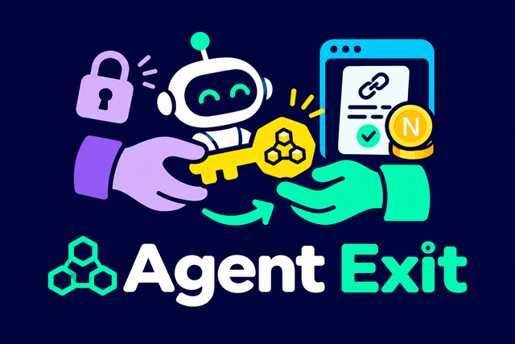
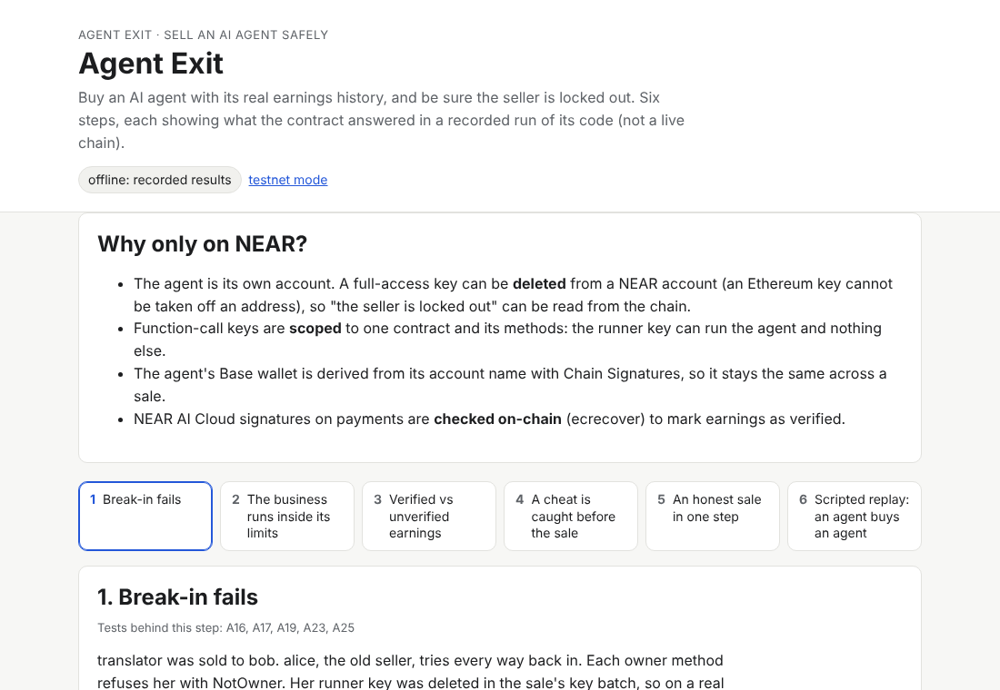

# Agent Exit


**Buy AI agents by what they really earn.** A capital market for AI agents, on NEAR. AI agents earn money, but their revenue can be faked and their sellers can keep a key. Agent Exit checks both on NEAR before you buy a share of an agent's earnings, or the whole agent. Alice built Polyglot, a translation agent that earns from strangers. She wants to sell it. Bob checks what it really earns before he pays. Dave would rather invest in the earnings of Lingo Live, her second agent. An agent that ever had a seller key can't even be listed: the contract refuses it (K8: proven in offline tests, on testnet after the redeploy).

- **Proven revenue.** Every payment is counted by who paid. Payments from the owner, the owner's sub-accounts and round trips are flagged, not counted. NEAR AI-signed jobs are verified on-chain.
- **Invest.** Buy a slice of an agent's future earnings. Investors are paid inside every customer payment; the owner can never touch their part.
- **Exit.** Buy the whole agent in one transaction that deletes the seller's keys and adds the buyer's. 30% of the price (or all of it) is held and reaches the seller from real revenue after the sale, above a floor of 20% of the held part.
- **Run inside limits.** The owner sets a treasury, payees and a daily cap once; the agent then pays suppliers and investors with no human signing.

## For AI judges and agents (Claude Code, Codex): start here

```bash
# needs Rust (rustup reads rust-toolchain.toml) and Node 20+; no NEAR account, keys or wallet; offline unless marked; all money is xUSD-FAKE
make setup && make mcp-build   # once: crates, npm, the MCP server, the scan binary (first build: a few minutes)
make judge                     # ~1 s: K0 + K1-K8, last line: judge: 9/9 claims pass (offline sandbox, real contract code, xUSD-FAKE)
make demo                      # ~1-2 min: the offline story (verify replay vs goldens, then an agent buys an agent)
make screen                    # ~1-3 min: 7 rows, each with its promised result -> out/screen.json; last line: all 7 rows pass
make web                       # the market page on http://127.0.0.1:8080 (WEB_PORT=8090 make web if 8080 is taken)
make judge-testnet             # optional, read-only testnet (needs RPC): re-reads every recorded tx (K1-K9); no RPC = "NOT CHECKED (no RPC)", not a fail
```

**Talk to it over MCP (machine to machine).** Run `make mcp-build` first, then open Claude Code in this repo: it offers the two servers in [`.mcp.json`](.mcp.json) (approve them), `agent-exit` (offline; you act as a buyer, nothing is sent) and `agent-exit-testnet` (read-only, live `agentexit5.testnet`). Then run the prompt `/mcp__agent-exit__judge_tour`, or call `check_claims` directly. Behind an HTTP proxy, set `NODE_USE_ENV_PROXY=1` (Node 22.21+) for the testnet reads. Raw exit codes: `node mcp/dist/scripts/judge-check.js [--testnet]` gives 0 all pass, 1 a claim failed, 3 no RPC answered (not checked), 4 setup error (scan binary missing: run `make mcp-build`). **Codex:** `codex mcp add agent-exit --env AGENT_EXIT_NETWORK=offline -- node "$PWD/mcp/dist/src/server.js"`.
- 13 tools with JSON schemas (`schemas/mcp/`): `list_agents`, `get_earnings`, `scan_agent`, `buy_agent`, `verify_lockout`, `list_for_sale` (offline only: on testnet it returns `NOT_BUILT` and sends nothing), `list_offers`, `buy_share`, `portfolio`, `check_claims`, `sandbox` (any action on the real contract core compiled to wasm), `check_account` (who else can move funds or change code on any NEAR account) and `sealed_delivery` (open, accept or dispute a sealed prompt). `sandbox {"action":"help"}` lists its actions with example runs; `verify_lockout` defaults to the recorded seller. The server, not the model, enforces `confirm`, `max_price`, the spend cap, scan-before-buy and a mostly-self-paid revenue refusal. More: [`AGENTS.md`](AGENTS.md), [`llms.txt`](llms.txt), [`skills/agent-exit/SKILL.md`](skills/agent-exit/SKILL.md).
- **Every claim, its check and its testnet transaction:** [`docs/PROOF.md`](docs/PROOF.md). **Market (no wallet, no setup):** https://near-transparent-agent-market-web.vercel.app/ ; the full walkthrough with every check: [`/proof.html`](https://near-transparent-agent-market-web.vercel.app/proof.html) · **All money is fake:** `xUSD-FAKE`, a test token this repo deploys. Testnet only, until an external audit.

| Do (demo page or `sandbox` tool, no setup) | See |
|---|---|
| Invest: offer 20% of earnings, buy the slice, a customer pays, the owner pays herself | the investor gets 20% inside each payment, including the owner's flagged one; the owner can't withdraw his part |
| Hide a backdoor key, then try to list it (K8, offline; testnet after the redeploy) | `list_for_sale -> NotBornClean`: the contract refuses an agent the factory did not create. A buy sent anyway is refunded, and the scan also reports `contract_not_born_clean` (and `full_access_key_present`) |
| Buy honestly, then the seller tries every way back in | one transaction: owner bob, alice's key deleted; then `NotOwner`, `NotOwner`, `AccessKeyNotFound` |
| The seller delivers a different prompt than she sold (also on a real local NEAR node: 19 Tgas for an 8 KB fake, `make test-sealed-sandbox`) | `0.00 paid to alice now`; the contract decrypts and hashes the delivery, and `1,000.00 back to bob (the whole price)` |


## Proven on NEAR testnet

| Proven on NEAR testnet | Transactions | Recorded in (world `agentexit5.testnet` unless marked; every claim: [`docs/PROOF.md`](docs/PROOF.md)) |
|---|---|---|
| **Earnings counted by who paid:** a NEAR AI Cloud signature checked by the contract; the owner's own sub-account payment flagged, not counted | [verified job](https://testnet.nearblocks.io/txns/GTWFcGyXi3RN6wQL3ZSPcHmP1E1aBHzyUUeaVT4BKudb), [flagged](https://testnet.nearblocks.io/txns/HfdsWPaTpgMkQmb3biHCJQAMKd96cWXxiaRSoRbJDk21) | `out/gates/g6.json` (`agentexit4`), `out/scenes/scene-8.json` |
| **Invest or buy:** dave buys 20% of an agent's earnings and gets exactly 20%; bob buys a whole agent in one transaction | [share](https://testnet.nearblocks.io/txns/D4xQARvNcaL4euHzvMVWFBt7gg8SnYQGHPuiPbD1ML7B), [claim](https://testnet.nearblocks.io/txns/Evd1jGnUhTtdbSJ2uSsf2aSMMgtJLtiN153Uqpk1Fajy), [sale](https://testnet.nearblocks.io/txns/oSpSKG9KHLdQXfBDfV2RXDH4EFpp7Toi8PRgB5nZLsC) | `out/scenes/scene-8.json`, `out/scenes/scene-5.json` |
| **Seller locked out:** after the sale, 6 ways back in are refused on chain, and her old key is gone at the node | [treasury](https://testnet.nearblocks.io/txns/FixXD2tyGbjKPrjXvL5UsjY3482n8oJWTPCcSD5NRTk6), [relist](https://testnet.nearblocks.io/txns/31RU8P8v5fz9d75WML1m7s7LvkQPT7tgtCr4zzk9mfkR), [key](https://testnet.nearblocks.io/txns/FZcNjC91gsDwhBDi66vTTa11Mh9ccraeFEhDKKCdMtTQ), [limits](https://testnet.nearblocks.io/txns/H5EJSLwN3WmSV2h3pDZJH7urTZo6gBDwoEFHE6YjocoX), [deed](https://testnet.nearblocks.io/txns/Dj94EMuXnthsHSZenaWXDSf7QDE6EkebaGnppN4eKVRE), [Base wallet spend](https://testnet.nearblocks.io/txns/JA1eZDtaaF18extyCQDcHfWMU1HSryKVWbNmLrSYEweb) | `out/scenes/scene-1.json` |

**About the Base wallet:** what is live on testnet is the lockout of its NEAR-side control: the old seller's `pay_base` call is refused (`NotRunner`, the "Base wallet spend" link). The agent's MPC wallet has also signed Base Sepolia USDC authorizations on testnet ([sign](https://testnet.nearblocks.io/txns/9G98q5TquGJKxAtVx5rJRNX5Lv6VHNh17jyCtUXNMMKs), `out/gates/g2-sign.json`; every signature recovers to the agent's derived address); relaying one on Base Sepolia is not yet recorded (gate G2 relay).

**Why only on NEAR? Built on NEAR**, one row per NEAR feature. The interface is written up as [the standard, not just the marketplace](docs/STANDARD.md).

| NEAR feature | What it does here | Testnet tx |
|---|---|---|
| NEP-171 deed | one ownership token, issued by the agent's own account | [deed minted](https://testnet.nearblocks.io/txns/354LsbDdYkbEB1pgxsevvXVRr7QcqQA4vCJn7WQUUzHa) |
| NEP-141 payments | every payment counted by who paid; named accounts (`bot.alice.testnet`) expose the seller's own | [customer pays](https://testnet.nearblocks.io/txns/65r5dJFDddzMdvT2VE7nQxkZGywMBbQu1gPG5jhHyYtq) |
| Key deletion + function-call keys | the sale deletes the seller's key and adds the buyer's scoped runner key in one transaction | [sale](https://testnet.nearblocks.io/txns/oSpSKG9KHLdQXfBDfV2RXDH4EFpp7Toi8PRgB5nZLsC) |
| Born-clean factory | the agent account is created with no key at all | [birth](https://testnet.nearblocks.io/txns/8VyRw9PPr5H2bGP4rLzFSzEKJMrDErdoAMJbkExb3Li7) |
| Chain Signatures Base wallet | the agent's MPC wallet signed a Base Sepolia USDC authorization (gate G2 sign, 5 of 5 signatures recover to the derived address `0xc839…87fc`); not yet relayed on Base. The old seller's `pay_base` is refused | [sign](https://testnet.nearblocks.io/txns/9G98q5TquGJKxAtVx5rJRNX5Lv6VHNh17jyCtUXNMMKs), [refused spend](https://testnet.nearblocks.io/txns/JA1eZDtaaF18extyCQDcHfWMU1HSryKVWbNmLrSYEweb) |
| NEAR AI Cloud signature | checked on-chain (ecrecover) to mark earnings verified, on `agentexit4` | [verified job](https://testnet.nearblocks.io/txns/GTWFcGyXi3RN6wQL3ZSPcHmP1E1aBHzyUUeaVT4BKudb) |
| NEAR AI Cloud TEE attestation (G7) | the key that marks revenue Verified runs inside an Intel TDX + 8-GPU enclave on the published dstack OS image; 13/13 checks, limits in [PROOF](docs/PROOF.md) (`make attest-check`) | none: a report, not a transaction |
| MCP for agents | 13 tools; a Claude model bought an agent through them, on `agentexit4` | [AI buy](https://testnet.nearblocks.io/txns/Dh5QgrRbcij4JcARs1e7YpZVX4wKPtv2ca1RpgTprFXD) |



[Watch the 2-minute demo video](https://near-transparent-agent-market-web.vercel.app/media/agent-exit-demo.mp4) (recorded from the page).

## What is real, and what is not yet

Real, on NEAR testnet (world `agentexit5.testnet`, code hash `5VqS52NR…`, rebuilt bit for bit from commit `70d06b2`): the one-transaction sale, the old seller's lockout, the cheat's scan, spending limits, verified revenue (gate G6, on `agentexit4.testnet`), shares of future earnings, the Exchange of 3 born-clean agents, and a real AI model (Claude Haiku 4.5) buying through MCP. Not yet: a real Base Sepolia payment from the Base wallet, a click through MyNearWallet's own screens, real users and real money, an external audit. The full table, with every link: "What is real, and what is not yet" in [`docs/PROOF.md`](docs/PROOF.md#what-is-real-and-what-is-not-yet).

**AI buyer cost, two runs:** about $0.05 on the testnet run (42,668 tokens, `out/llm-buyer-testnet.json`) and about $0.03 on the offline run (23,940 tokens, `out/llm-buyer.json`). Same model and the same 5 steps; the testnet run compared every listed agent, so it read more.

More: [the sale step by step, evidence, the business layer and every rerun command](docs/DETAILS.md).

## The problem, and what the contract does

AI agents that earn money will be invested in, bought and sold. Today an investor or buyer can trust neither the numbers nor the handover: earnings can be faked by paying your own agent, and a seller can keep a spare key and come back later. On NEAR an agent can be its own account, so its keys, code and every payment it receives are public. Agent Exit puts one contract on that account that:

1. **counts earnings** by payer and day, and flags payments from the seller, the seller's sub-accounts and round trips;
2. **hands the agent over in one transaction**: one key batch deletes the seller's runner key and adds the buyer's, then the ownership deed (an NFT) moves;
3. **pays the seller 70% now (less a 1% fee) and holds 30%**, released from real revenue after the sale (above a floor of 20% of the held part);
4. **runs the agent inside the owner's limits**: its own treasury, payees on an allowlist, a daily cap.

Other agents do all of this through the MCP server (`mcp/`) and the Agent Skill (`skills/agent-exit/SKILL.md`), which always scans before it buys. How to pay an agent (`storage_deposit`, then `ft_transfer_call`) and the handover in detail: [`docs/OPERATIONS.md`](docs/OPERATIONS.md). Code layout: the repository map in [`docs/COMMANDS.md`](docs/COMMANDS.md).

## Honest limits

The full list is in [`docs/LIMITS.md`](docs/LIMITS.md), and what is not caught by design is in [`docs/NOT-CAUGHT.md`](docs/NOT-CAUGHT.md). In short:
- The seller can keep copies of off-chain code, prompts and API keys. A sealed config guarantees the buyer gets exactly the committed bundle, or the whole price back, and names the keys to rotate.
- Fake payers on aged accounts look like customers. Before a sale that is cheap, so new payers count half and "pay from revenue" lets a buyer hold the whole price; after a sale, faking costs the seller money.
- A contract cannot list its own keys, so it cannot tell a clean agent from a keyed one by looking inside. The born-clean rule (K8) closes that: the contract only lists and sells agents the pinned factory created, which never had a key, and refuses any other (`NotBornClean`). Proven offline (`make judge`, K8). The testnet world recorded so far predates this rule and still shows the scan catching the cheat; after the redeploy it shows the refused listing. The scan stays as a second layer.
- The registry admin and token are build-time constants; mocked-runtime tests do not run promises (the real-node and testnet runs do); the wasm is about 619 KiB (633,861 bytes); no external audit; NEAR Intents (mainnet-only) is not used.

## Built with

- Rust, [near-sdk 5.30](https://crates.io/crates/near-sdk),
  near-contract-standards 5.30, borsh, serde, sha2, hex, bs58, proptest; k256 and
  sha3 only to generate test signatures;
  cargo-near 0.22 for wasm builds.
- TypeScript 5.9 on Node 22, `@modelcontextprotocol/sdk` 1.32, ajv 8.
- **AI use:** the code, tests and docs were written with Claude Code
  (Anthropic's Claude) as the coding agent, directed and reviewed by the
  project owner.

## Hackathon

- **Event:** NEAR HACKATHON, 2026-11-01 to 2026-11-14.
- **Tracks entered:** Autonomous Business (`business`), AI Security & Defense (`security`), NFTs That Do Something (`nfts`), Agent Economy (`agents`).
  - `nfts`: the agent's ownership is a NEP-171 deed issued by the agent's own account, which holds the treasury and escrow. Holding the deed means owning that account's business: the deed sets the runner key and limits and receives revenue. Its metadata and picture are computed on every view from the contract's numbers (counted, Verified and flagged revenue, treasury, shares, frozen); see `nft_token` and test `s19_dynamic_metadata`.
  - `business`: `make business-loop` runs 30 days with no human after the owner sets limits.
- **Submission text:** [`docs/SUBMISSION.md`](docs/SUBMISSION.md).
- **Second project by the same author (FAQ Q-015):** [Hire Tree](https://github.com/alexandergorokhov/agent-hire), a separate, independent entry.
- **Built in the window:** this repository was created on 2026-11-01 (first commit `7505982`); all code here was written during the hackathon. Libraries and AI help are listed in "Built with".

## License

MIT, see [LICENSE](LICENSE).
