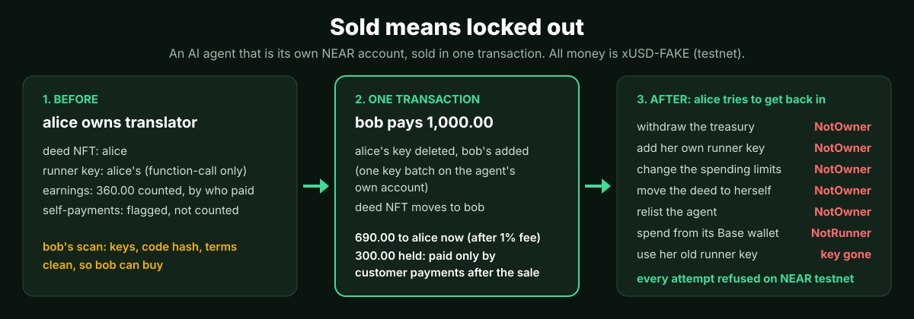
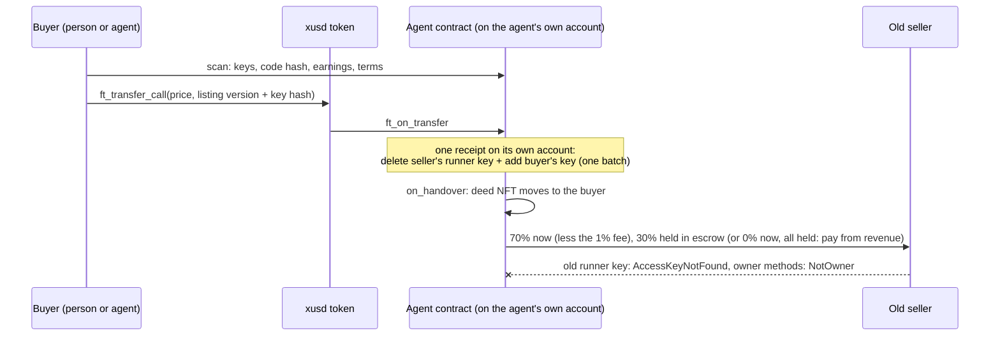

# Agent Exit

**A capital market for AI agents, on NEAR.** AI agents already earn money, so they are small businesses, yet nobody can invest in one or buy one from a stranger: the revenue can be faked and the seller can keep a key. On NEAR an agent is its own account, so Agent Exit puts one contract on that account that makes the business checkable:

- **Proven revenue.** Every payment is counted by who paid; payments from the owner, the owner's sub-accounts and round trips are flagged, not counted; NEAR AI-signed jobs are verified on-chain.
- **Invest.** Buy a slice of an agent's future earnings. Investors are paid inside every customer payment, and the owner can never touch their part.
- **Exit.** Buy the whole agent in one transaction that deletes the seller's keys and adds the buyer's. 30% of the price (or all of it) is paid to the seller only from real revenue after the sale; a sealed prompt is paid for only once the buyer gets the bundle that was committed.
- **Run inside limits.** The owner sets a treasury, payees and a daily cap once; the agent then pays suppliers and investors with no human signing.

## For AI judges and agents (Claude Code, Codex)

```bash
make setup && make mcp-build      # once: crates, npm, the MCP server and the scan binary
make judge                        # the MCP server from .mcp.json checks the README's seven main claims: one PASS/FAIL row each
make screen                       # 7 rows: judge, playground, scan, business loop, MCP tests, contract tests, .mcp.json (1-3 min)
```

- **Claude Code** opened in this repo gets two MCP servers from [`.mcp.json`](.mcp.json): `agent-exit` (offline, results recorded from the real contract code, you act as a buyer) and `agent-exit-testnet` (read-only, live testnet: there `check_claims` re-reads every recorded transaction from archival nodes and the agents as they are now). Approve the project servers when Claude Code asks, then call `check_claims` first, or run the prompt `/mcp__agent-exit__judge_tour`: verify each claim with the tools, then try to break it.
- **Codex:** `codex mcp add agent-exit --env AGENT_EXIT_NETWORK=offline -- node "$PWD/mcp/dist/src/server.js"` (read-only; `check_claims` still runs its own sandbox).
- 13 tools with JSON schemas (`schemas/mcp/`): `list_agents`, `get_earnings`, `scan_agent`, `buy_agent`, `verify_lockout`, `list_for_sale`, `list_offers`, `buy_share`, `portfolio`, `check_claims`, `sandbox` (any action, in any order, on the real contract core and scan compiled to wasm: fake revenue, hide a key, buy without the scan, try every way back in) `check_account` (who else can move funds or change code on any NEAR account) and `sealed_delivery` (see a random, proven sample of the agent's sealed prompt before buying; open, accept or dispute it after). The server, not the model, enforces `confirm`, `max_price`, the spend cap and scan-before-buy. More: [`AGENTS.md`](AGENTS.md), [`llms.txt`](llms.txt), [`skills/agent-exit/SKILL.md`](skills/agent-exit/SKILL.md).
- **Demo page (no wallet, no setup):** https://near-transparent-agent-market-web.vercel.app/ (its "Check any NEAR account" box reads any testnet account live) · **All money is fake:** `xUSD-FAKE`, a test token this repo deploys. Testnet only; no mainnet before an external audit.



| Do (demo page or `sandbox` tool, no setup) | See |
|---|---|
| Invest: offer 20% of earnings, buy the slice, a customer pays, the owner pays herself | the investor gets 20% inside each payment, including the owner's flagged one; the owner can't withdraw his part |
| Hide a backdoor key, list, scan, buy | `scan -> blocked (full_access_key_present)`, then `SCAN_BLOCKED`: no money moves |
| Buy honestly, then the seller tries every way back in | one transaction: owner bob, alice's key deleted; then `NotOwner`, `NotOwner`, `AccessKeyNotFound` |
| The seller delivers a different prompt than she sold (also on a real local NEAR node: 19 Tgas for an 8 KB fake, `make test-sealed-sandbox`) | `0.00 paid to alice now`; the contract decrypts and hashes the delivery, and `1,000.00 back to bob (the whole price)` |

## Try it in 2 minutes (do X, see Y)

The page's missions 4, 2, 3 and 6 are the four rows above. Three more checks below. More of the business (earnings by payer, pay from revenue, spending limits) is in [The business layer](#the-business-layer).

| Do | See |
|---|---|
| Mission 2: "Buy without a clean scan", then "Take the agent back" | the hidden key redeploys and the seller has the agent back: the scan is the defence |
| `make check-account ID=trading-bot.testnet` (or MCP `check_account`) on `trading-bot.testnet`, `locked-vault.testnet`, then `translator.testnet` (or any testnet account, named or implicit, with the `agent-exit-testnet` server) | `backdoor_risk`: a full-access key on a contract and an `upgrade` method (also any key the contract never installed, or a NEAR global contract another account can swap); `no_key_unknown_code`: no key, but code we cannot check; `locked`: no key and the published build, which has no upgrade method |
| "The same story on NEAR testnet": open a scenario, press "Run and verify" | each stage is fetched from NEAR testnet now (signer, method, outcome, the contract's event logs) and marked `confirmed on chain` |

Offline: `cargo test -p playground`. Everything else: `make setup` once, then `make demo` (offline story) and `make web` (the page at http://127.0.0.1:8080).

## Proven on NEAR testnet

| Proven on NEAR testnet | Transactions |
|---|---|
| **Earnings counted by who paid:** a NEAR AI Cloud signature checked by the contract; the owner's own sub-account payment flagged, not counted | [verified job](https://testnet.nearblocks.io/txns/GTWFcGyXi3RN6wQL3ZSPcHmP1E1aBHzyUUeaVT4BKudb), [flagged](https://testnet.nearblocks.io/txns/HfdsWPaTpgMkQmb3biHCJQAMKd96cWXxiaRSoRbJDk21) |
| **Invest or buy:** dave buys 20% of an agent's earnings and gets exactly 20%; bob buys a whole agent in one transaction | [share](https://testnet.nearblocks.io/txns/D4xQARvNcaL4euHzvMVWFBt7gg8SnYQGHPuiPbD1ML7B), [claim](https://testnet.nearblocks.io/txns/Evd1jGnUhTtdbSJ2uSsf2aSMMgtJLtiN153Uqpk1Fajy), [sale](https://testnet.nearblocks.io/txns/oSpSKG9KHLdQXfBDfV2RXDH4EFpp7Toi8PRgB5nZLsC) |
| **Seller locked out:** after the sale, all 6 ways back in fail | [treasury](https://testnet.nearblocks.io/txns/FixXD2tyGbjKPrjXvL5UsjY3482n8oJWTPCcSD5NRTk6), [relist](https://testnet.nearblocks.io/txns/31RU8P8v5fz9d75WML1m7s7LvkQPT7tgtCr4zzk9mfkR), [key](https://testnet.nearblocks.io/txns/FZcNjC91gsDwhBDi66vTTa11Mh9ccraeFEhDKKCdMtTQ), [limits](https://testnet.nearblocks.io/txns/H5EJSLwN3WmSV2h3pDZJH7urTZo6gBDwoEFHE6YjocoX), [deed](https://testnet.nearblocks.io/txns/Dj94EMuXnthsHSZenaWXDSf7QDE6EkebaGnppN4eKVRE), [Base wallet](https://testnet.nearblocks.io/txns/JA1eZDtaaF18extyCQDcHfWMU1HSryKVWbNmLrSYEweb) |

**Why only on NEAR?** The agent is its own account, and that is what makes the sale checkable:
- a full-access key can be **deleted** from a NEAR account (an Ethereum key cannot be taken off an address), and an account can be **born with no key** (live on testnet: the factory's one batch creates it, deploys the published code and runs `new`), so "the seller is locked out" can be read from the chain;
- function-call keys are **scoped** to one contract and its methods, so the runner key can run the agent and nothing else;
- named accounts make the seller's own sub-accounts (`bot.alice.testnet`) visible, so their payments are flagged;
- the agent's **Base wallet** is derived from its account name with Chain Signatures, so it stays the same across a sale;
- NEAR AI Cloud signatures on payments are **checked on-chain** (ecrecover) to mark earnings as verified.


[Watch the 2-minute 15-second demo video](https://near-transparent-agent-market-web.vercel.app/media/agent-exit-demo.mp4) (recorded from the page).

## What is real, and what is not yet

| Real (on NEAR testnet, with NearBlocks links) | Not yet |
|---|---|
| The contract on NEAR testnet, rebuilt bit for bit from the deployed commit (`git checkout 70d06b2 && make build`: code hash `5VqS52NR…`, world `agentexit5.testnet`, deployed 2026-11-10). It includes the 1% protocol fee, the live deed picture with an `nft_mint` event, the latest review fixes, pay from revenue and the sealed config, all live on testnet; every link in this README resolves (`make check-links`) | The agent's Base wallet (Chain Signatures) paying on Base Sepolia |
| Old-seller lockout, the cheat's scan, spending limits and the one-transaction sale | The page's Invest button (a MyNearWallet sign link; tested offline, byte-exact with near-js) has not yet been clicked through on testnet |
| Verified revenue (gate G6, 2026-11-10, recorded on the previous world `agentexit4.testnet` with the same contract features): a real NEAR AI Cloud signature (TEE signer `0xfe00…337e`) checked by the contract ([tx](https://testnet.nearblocks.io/txns/GTWFcGyXi3RN6wQL3ZSPcHmP1E1aBHzyUUeaVT4BKudb)) | The Exchange board (scene 13: several born-clean agents with mixed payers) on testnet: waiting for test NEAR |
| A real AI model (Claude Haiku) bought an agent through the MCP tools on testnet: refused the cheat, bought the translator, checked the lockout, about $0.05 ([buy tx](https://testnet.nearblocks.io/txns/Dh5QgrRbcij4JcARs1e7YpZVX4wKPtv2ca1RpgTprFXD) on `agentexit4.testnet`, `out/llm-buyer-testnet.json`) | Real users and real money: everything is `xUSD-FAKE` |
| Shares of future earnings (scene 8, `translator3`): dave bought 20% ([buy](https://testnet.nearblocks.io/txns/D4xQARvNcaL4euHzvMVWFBt7gg8SnYQGHPuiPbD1ML7B)), 5 customers paid for real NEAR AI translations, each verified ([a job](https://testnet.nearblocks.io/txns/CCYk7MR4Tw59iHv7aNcNc2ALtgYcENTm6aM2VCcro4CL)); the owner's sub-account paid too, was flagged and released no escrow; dave got exactly 20% ([claim](https://testnet.nearblocks.io/txns/Evd1jGnUhTtdbSJ2uSsf2aSMMgtJLtiN153Uqpk1Fajy)) | An external security audit (not an offer of securities; testnet demo) |

Use it with your own agent (a standalone account check, a payment guard, the MCP server, the born-clean factory): [`docs/INTEGRATE.md`](docs/INTEGRATE.md). Who pays, a worked example, risks and how it compares with Acquire, Olas and Virtuals: [`docs/BUSINESS.md`](docs/BUSINESS.md). Mainnet gates: [`docs/ROADMAP.md`](docs/ROADMAP.md). Reporting issues: [`SECURITY.md`](SECURITY.md). Every claim and its test: [`docs/PROOF.md`](docs/PROOF.md). Edge cases and attacks: [`docs/SCENARIOS.md`](docs/SCENARIOS.md). For AI agents: [`AGENTS.md`](AGENTS.md), [`llms.txt`](llms.txt).

## One sale



## Evidence

- **Real node:** the `tests/sandbox` tests (key list before and after a buy, the old keys failing with the node's own error, a failed key batch refunding the buyer) passed on a local NEAR node at commits `609b135` and `63d597c` (`make test-sandbox`). The sealed-prompt dispute (SC-S1/S2): a fake 8 KB delivery is decrypted on-chain and the whole 1,000.00 goes back to the buyer at 19 Tgas; an honest one cannot be disputed and the seller is paid (`make test-sealed-sandbox`, 2026-11-09).
- **Offline, every run:** 73 checks through the real contract code against checked-in goldens (`make verify`), property tests, 185 MCP tests. Attack suite: 20 attack families, 19 counted (A9 Base not counted until live); each blocked by its rule; 0/50 false positives. It is a regression suite, not independent evidence, written by the same author. The code-hash check uses the reproducible build in `contracts/res/SHA256SUMS`.
- **Found and fixed on a real node:** a stress run bricked an agent at about 585 payers (every call trapped while loading state); the cause is unconfirmed (likely one allocation over 64 KiB). The fix keeps payer and day rows out of the state blob; covered by `a47_thousand_long_payers_then_buy_and_views` (1,000 payers, then a buy and every view). A payer row now costs 0.024 NEAR (`storage_deposit`).
- **Live on NEAR testnet:** the six scenes, a fresh-agent sale check, the NEAR AI signature check and scene 8 (shares), re-recorded 2026-11-10 on `agentexit5.testnet` with every link checked, together with scene 9 (an agent [born clean](https://testnet.nearblocks.io/txns/2Rgj3r37wUx22ySBK5PZWM45JNP68U4RxRDHzv5zDpLD) in the factory, no key ever), scene 10 (sealed prompt), scene 11 (a business day), scene 12 (an open share offer) and an MCP agent that [invests](https://testnet.nearblocks.io/txns/5ijxcigmGFmXDGym3p3S5jf9kwKnPQJ5HineUcoS8aPr) in it by a fixed rule (`make agent-invests-testnet`; the rule accepts NEAR AI-verified revenue because scene 8's customers paid without registering payer rows, so `counted_payers` is 0 while all 100.00 is counted and 50.00 is verified); the AI buyer and gate G6 ran on the previous world `agentexit4.testnet` (table below; outputs in `out/scenes/`, `out/gates/`).
- **A real AI buyer:** Claude Haiku 4.5, given only the Agent Skill and the MCP tools (offline fixtures), rejected the cheat on its flagged earnings, scanned translator, bought it inside its 1,000 limit and checked the old seller is locked out: 5 steps, about $0.03. Every testnet transaction: [`docs/TESTNET.md`](docs/TESTNET.md).

## The problem, and what the contract does

AI agents that earn money will be invested in, bought and sold. Today an investor or buyer can trust neither the numbers nor the handover: earnings can be faked by paying your own agent, and a seller can keep a spare key and come back later. On NEAR an agent can be its own account, so its keys, code and every payment it receives are public. Agent Exit puts one contract on that account that:

1. **counts earnings** by payer and day, and flags payments from the seller, the seller's sub-accounts and round trips;
2. **hands the agent over in one transaction**: one key batch deletes the seller's runner key and adds the buyer's, then the ownership deed (an NFT) moves;
3. **pays the seller 70% now (less a 1% fee) and holds 30%**, released only from real revenue after the sale;
4. **runs the agent inside the owner's limits**: its own treasury, payees on an allowlist, a daily cap.

Other agents do all of this through the MCP server (`mcp/`) and the Agent Skill (`skills/agent-exit/SKILL.md`), which always scans before it buys. How to pay an agent (`storage_deposit`, then `ft_transfer_call`) and the handover in detail: [`docs/OPERATIONS.md`](docs/OPERATIONS.md). Code layout: the repository map in [`docs/COMMANDS.md`](docs/COMMANDS.md).


## The business layer

What makes an agent worth investing in or buying. All on the same contract, all runnable on the page or with the `sandbox` tool:

| Do | See |
|---|---|
| `make business-loop` (offline, real contract code) | 30 days with no human after the setup: customers pay 1,555.00, dave gets exactly 10% (155.50), the runner buys 118 jobs from another agent inside its 8.00 daily cap; `PolicyViolation:DailyCap` and `PolicyViolation:Payee` refuse the rest (`out/business-loop.json`) |
| Mission 1: "Pay your own agent 200" | `FLAGGED: the owner paid their own agent (not counted)`; counted revenue does not move |
| Mission 4: offer 20%, "Buy the 20% slice", a customer pays, alice pays herself | dave gets `5.00 to investors` and `40.00 to investors` inside the same calls; alice can't withdraw his part; a year later `245.00 of unreleased escrow back to dave` |
| Mission 5: list "paid only from revenue", buy, alice fakes 200 from a fresh wallet | `0.00 paid to alice now: all 1,000.00 is held`; then `paid 200.00 and got 100.00 back: faking revenue cost 100.00`: after a sale, faking always loses money |

## Rerun it (humans and AI agents)

Rust (pinned in `rust-toolchain.toml`), `make`, Node >= 20. No NEAR account and no network after `make setup`. Every command, with what it prints: [`docs/COMMANDS.md`](docs/COMMANDS.md).

| Do | See |
|---|---|
| `make demo` | the offline story in one command: the verify replay and the scripted agent-buys-agent replay |
| `make verify` | unit and property tests, then the fixed world through the real contract code equals `tests/golden/verify.json` and `tests/golden/attack.json` |
| `make attack` | 200 seeded attack variants and 50 clean agents through the scan; 0/50 false positives |
| `make mcp-test` | the MCP server's 185 tests offline, then the scripted run equals `tests/golden/agent-buys-agent.json` |
| `make web` | the demo page at http://127.0.0.1:8080 (offline; `?network=testnet` reads live through a read-only relay) |
| `make test-sandbox`, `make test-sealed-sandbox` | the handover and the sealed-prompt dispute on a real local NEAR node |


## Honest limits

The full list is in [`docs/LIMITS.md`](docs/LIMITS.md), and what is not caught by design is in [`docs/NOT-CAUGHT.md`](docs/NOT-CAUGHT.md). In short:
- The seller can keep copies of off-chain code, prompts and API keys. A sealed config guarantees the buyer gets exactly the committed bundle, or the whole price back, and names the keys to rotate.
- Fake payers on aged accounts look like customers. Before a sale that is cheap, so new payers count half and "pay from revenue" lets a buyer hold the whole price; after a sale, faking costs the seller money.
- A contract cannot list its own keys: the buyer's scan catches a hidden key before the sale (agents from the born-clean factory never had one; live on testnet since 2026-11-10, scene 9).
- The registry admin and token are build-time constants; mocked-runtime tests do not run promises (the real-node and testnet runs do); the wasm is about 550 KB; no external audit; NEAR Intents (mainnet-only) is not used.


## Built with

- Rust, [near-sdk 5.30](https://crates.io/crates/near-sdk),
  near-contract-standards 5.30, borsh, serde, sha2, hex, bs58, proptest; k256 and
  sha3 only to generate test signatures;
  cargo-near 0.22 for wasm builds.
- TypeScript 5.9 on Node 22, `@modelcontextprotocol/sdk` 1.32, ajv 8.
- **AI use:** the code, tests and docs were written with Claude Code
  (Anthropic's Claude) as the coding agent, directed and reviewed by the
  project owner.

## Hackathon

- **Event:** NEAR HACKATHON, 2026-11-01 to 2026-11-14.
- **Tracks entered:** Autonomous Business (`business`), AI Security & Defense (`security`), NFTs That Do Something (`nfts`), Agent Economy (`agents`).
  - `nfts`: the agent's ownership is a NEP-171 deed issued by the agent's own account, which holds the treasury and escrow. Holding the deed means owning that account's business: the deed sets the runner key and limits and receives revenue. Its metadata and picture are computed on every view from the contract's numbers (counted, Verified and flagged revenue, treasury, shares, frozen); see `nft_token` and test `s19_dynamic_metadata`.
  - `business`: `make business-loop` runs 30 days with no human after the owner sets limits.
- **Second project by the same author (FAQ Q-015):** [Hire Tree](https://github.com/alexandergorokhov/agent-hire), a separate, independent entry.
- **Built in the window:** this repository was created on 2026-11-01 (first commit `7505982`); all code here was written during the hackathon. Libraries and AI help are listed in "Built with".

## License

MIT, see [LICENSE](LICENSE).
