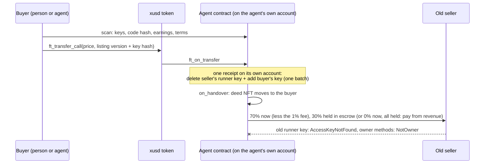

# Agent Exit

**A capital market for AI agents, on NEAR.** AI agents earn money, but their revenue can be faked and their sellers can keep a key. Agent Exit checks both on NEAR, so you can buy a share of an agent's earnings, or the whole agent, safely.

- **Proven revenue.** Every payment is counted by who paid. Payments from the owner, the owner's sub-accounts and round trips are flagged, not counted. NEAR AI-signed jobs are verified on-chain.
- **Invest.** Buy a slice of an agent's future earnings. Investors are paid inside every customer payment; the owner can never touch their part.
- **Exit.** Buy the whole agent in one transaction that deletes the seller's keys and adds the buyer's. 30% of the price (or all of it) reaches the seller only from real revenue after the sale.
- **Run inside limits.** The owner sets a treasury, payees and a daily cap once; the agent then pays suppliers and investors with no human signing.

## For AI judges and agents (Claude Code, Codex): start here

```bash
make setup && make mcp-build   # once (Rust + Node 20): crates, npm, the MCP server, the scan binary
make judge                     # ~1 s once built; last line: judge: 8/8 claims pass (offline sandbox, real contract code, xUSD-FAKE)
make judge-testnet             # read-only testnet: re-reads every recorded tx (K1-K8); no RPC = exit 3, "unverified_network", never fail
make demo                      # the offline story; make screen runs 7 rows (judge, playground, scan, business loop, MCP, contract tests, .mcp.json)
```

- **MCP tour:** Claude Code opened in this repo gets two MCP servers from [`.mcp.json`](.mcp.json): `agent-exit` (offline, you act as a buyer) and `agent-exit-testnet` (read-only, live `agentexit5.testnet`). Run the prompt `/mcp__agent-exit__judge_tour`: verify each claim with `check_claims`, invest, buy, then try to break it. **Codex:** `codex mcp add agent-exit --env AGENT_EXIT_NETWORK=offline -- node "$PWD/mcp/dist/src/server.js"`.
- 13 tools with JSON schemas (`schemas/mcp/`): `list_agents`, `get_earnings`, `scan_agent`, `buy_agent`, `verify_lockout`, `list_for_sale` (offline only: on testnet it returns `NOT_BUILT` and sends nothing), `list_offers`, `buy_share`, `portfolio`, `check_claims`, `sandbox` (any action on the real contract core compiled to wasm), `check_account` (who else can move funds or change code on any NEAR account) and `sealed_delivery` (open, accept or dispute a sealed prompt). The server, not the model, enforces `confirm`, `max_price`, the spend cap and scan-before-buy. More: [`AGENTS.md`](AGENTS.md), [`llms.txt`](llms.txt), [`skills/agent-exit/SKILL.md`](skills/agent-exit/SKILL.md).
- **Every claim, its check and its testnet transaction:** [`docs/PROOF.md`](docs/PROOF.md). **Demo page (no wallet, no setup):** https://near-transparent-agent-market-web.vercel.app/ · **All money is fake:** `xUSD-FAKE`, a test token this repo deploys. Testnet only, until an external audit.

| Do (demo page or `sandbox` tool, no setup) | See |
|---|---|
| Invest: offer 20% of earnings, buy the slice, a customer pays, the owner pays herself | the investor gets 20% inside each payment, including the owner's flagged one; the owner can't withdraw his part |
| Hide a backdoor key, list, scan, buy | `scan -> blocked (full_access_key_present)`, then `SCAN_BLOCKED`: no money moves |
| Buy honestly, then the seller tries every way back in | one transaction: owner bob, alice's key deleted; then `NotOwner`, `NotOwner`, `AccessKeyNotFound` |
| The seller delivers a different prompt than she sold (also on a real local NEAR node: 19 Tgas for an 8 KB fake, `make test-sealed-sandbox`) | `0.00 paid to alice now`; the contract decrypts and hashes the delivery, and `1,000.00 back to bob (the whole price)` |


## Proven on NEAR testnet

| Proven on NEAR testnet | Transactions | Recorded in (world `agentexit5.testnet` unless marked; every claim: [`docs/PROOF.md`](docs/PROOF.md)) |
|---|---|---|
| **Earnings counted by who paid:** a NEAR AI Cloud signature checked by the contract; the owner's own sub-account payment flagged, not counted | [verified job](https://testnet.nearblocks.io/txns/GTWFcGyXi3RN6wQL3ZSPcHmP1E1aBHzyUUeaVT4BKudb), [flagged](https://testnet.nearblocks.io/txns/HfdsWPaTpgMkQmb3biHCJQAMKd96cWXxiaRSoRbJDk21) | `out/gates/g6.json` (`agentexit4`), `out/scenes/scene-8.json` |
| **Invest or buy:** dave buys 20% of an agent's earnings and gets exactly 20%; bob buys a whole agent in one transaction | [share](https://testnet.nearblocks.io/txns/D4xQARvNcaL4euHzvMVWFBt7gg8SnYQGHPuiPbD1ML7B), [claim](https://testnet.nearblocks.io/txns/Evd1jGnUhTtdbSJ2uSsf2aSMMgtJLtiN153Uqpk1Fajy), [sale](https://testnet.nearblocks.io/txns/oSpSKG9KHLdQXfBDfV2RXDH4EFpp7Toi8PRgB5nZLsC) | `out/scenes/scene-8.json`, `out/scenes/scene-5.json` |
| **Seller locked out:** after the sale, all 6 ways back in fail | [treasury](https://testnet.nearblocks.io/txns/FixXD2tyGbjKPrjXvL5UsjY3482n8oJWTPCcSD5NRTk6), [relist](https://testnet.nearblocks.io/txns/31RU8P8v5fz9d75WML1m7s7LvkQPT7tgtCr4zzk9mfkR), [key](https://testnet.nearblocks.io/txns/FZcNjC91gsDwhBDi66vTTa11Mh9ccraeFEhDKKCdMtTQ), [limits](https://testnet.nearblocks.io/txns/H5EJSLwN3WmSV2h3pDZJH7urTZo6gBDwoEFHE6YjocoX), [deed](https://testnet.nearblocks.io/txns/Dj94EMuXnthsHSZenaWXDSf7QDE6EkebaGnppN4eKVRE), [Base wallet spend](https://testnet.nearblocks.io/txns/JA1eZDtaaF18extyCQDcHfWMU1HSryKVWbNmLrSYEweb) | `out/scenes/scene-1.json` |

**About the Base wallet:** what is live on testnet is the lockout of its NEAR-side control: the old seller's `pay_base` call is refused (`NotRunner`, the "Base wallet spend" link). A real payment from the Base wallet on Base Sepolia is not yet recorded (gate G2).

**Why only on NEAR? Built on NEAR**, one row per NEAR feature. The interface is written up as [the standard, not just the marketplace](docs/STANDARD.md).

| NEAR feature | What it does here | Testnet tx |
|---|---|---|
| NEP-171 deed | one ownership token, issued by the agent's own account | [deed minted](https://testnet.nearblocks.io/txns/354LsbDdYkbEB1pgxsevvXVRr7QcqQA4vCJn7WQUUzHa) |
| NEP-141 payments | every payment counted by who paid; named accounts (`bot.alice.testnet`) expose the seller's own | [customer pays](https://testnet.nearblocks.io/txns/65r5dJFDddzMdvT2VE7nQxkZGywMBbQu1gPG5jhHyYtq) |
| Key deletion + function-call keys | the sale deletes the seller's key and adds the buyer's scoped runner key in one transaction | [sale](https://testnet.nearblocks.io/txns/oSpSKG9KHLdQXfBDfV2RXDH4EFpp7Toi8PRgB5nZLsC) |
| Born-clean factory | the agent account is created with no key at all | [birth](https://testnet.nearblocks.io/txns/8VyRw9PPr5H2bGP4rLzFSzEKJMrDErdoAMJbkExb3Li7) |
| Chain Signatures Base wallet | NEAR-side lockout live (old seller's `pay_base` refused); a Base Sepolia payment not yet | [refused spend](https://testnet.nearblocks.io/txns/JA1eZDtaaF18extyCQDcHfWMU1HSryKVWbNmLrSYEweb) |
| NEAR AI Cloud signature | checked on-chain (ecrecover) to mark earnings verified, on `agentexit4` | [verified job](https://testnet.nearblocks.io/txns/GTWFcGyXi3RN6wQL3ZSPcHmP1E1aBHzyUUeaVT4BKudb) |
| MCP for agents | 13 tools; a Claude model bought an agent through them, on `agentexit4` | [AI buy](https://testnet.nearblocks.io/txns/Dh5QgrRbcij4JcARs1e7YpZVX4wKPtv2ca1RpgTprFXD) |


[Watch the 2-minute 15-second demo video](https://near-transparent-agent-market-web.vercel.app/media/agent-exit-demo.mp4) (recorded from the page).

## What is real, and what is not yet

Real, on NEAR testnet (world `agentexit5.testnet`, code hash `5VqS52NR…`, rebuilt bit for bit from commit `70d06b2`): the one-transaction sale, the old seller's lockout, the cheat's scan, spending limits, verified revenue (gate G6, on `agentexit4.testnet`), shares of future earnings, the Exchange of 3 born-clean agents, and a real AI model (Claude Haiku 4.5) buying through MCP. Not yet: a real Base Sepolia payment from the Base wallet, a click through MyNearWallet's own screens, real users and real money, an external audit. The full table, with every link: "What is real, and what is not yet" in [`docs/PROOF.md`](docs/PROOF.md#what-is-real-and-what-is-not-yet).

**AI buyer cost, two runs:** about $0.05 on the testnet run (42,668 tokens, `out/llm-buyer-testnet.json`) and about $0.03 on the offline run (23,940 tokens, `out/llm-buyer.json`). Same model and the same 5 steps; the testnet run compared every listed agent, so it read more.

## One sale



## Evidence

The long version, with every link: "Evidence" in [`docs/PROOF.md`](docs/PROOF.md#evidence).

- **Real node:** the handover tests passed on a local NEAR node at commits `609b135` and `63d597c` (`make test-sandbox`); the sealed-prompt dispute too (`make test-sealed-sandbox`).
- **Offline, every run:** 73 checks through the real contract code against checked-in goldens (`make verify`), property tests, 188 MCP tests. Attack suite: 20 attack families, 19 counted (A9 Base not counted until live); each blocked by its rule; 0/50 false positives. It is a regression suite, not independent evidence, written by the same author. The code-hash check uses the reproducible build in `contracts/res/SHA256SUMS`.
- **Found and fixed on a real node:** a stress run bricked an agent at about 585 payers; the cause is unconfirmed. The fix keeps payer rows out of the state blob (test `a47_thousand_long_payers_then_buy_and_views`). A payer row now costs 0.024 NEAR (`storage_deposit`).
- **Live on NEAR testnet:** scenes 1-6 and 8-13, gate G1 and an MCP agent that invests by a fixed rule, on `agentexit5.testnet`; scene 7 (the AI buyer's listing), the AI buyer and gate G6 on `agentexit4.testnet`. Every testnet transaction: [`docs/TESTNET.md`](docs/TESTNET.md).

## The problem, and what the contract does

AI agents that earn money will be invested in, bought and sold. Today an investor or buyer can trust neither the numbers nor the handover: earnings can be faked by paying your own agent, and a seller can keep a spare key and come back later. On NEAR an agent can be its own account, so its keys, code and every payment it receives are public. Agent Exit puts one contract on that account that:

1. **counts earnings** by payer and day, and flags payments from the seller, the seller's sub-accounts and round trips;
2. **hands the agent over in one transaction**: one key batch deletes the seller's runner key and adds the buyer's, then the ownership deed (an NFT) moves;
3. **pays the seller 70% now (less a 1% fee) and holds 30%**, released only from real revenue after the sale;
4. **runs the agent inside the owner's limits**: its own treasury, payees on an allowlist, a daily cap.

Other agents do all of this through the MCP server (`mcp/`) and the Agent Skill (`skills/agent-exit/SKILL.md`), which always scans before it buys. How to pay an agent (`storage_deposit`, then `ft_transfer_call`) and the handover in detail: [`docs/OPERATIONS.md`](docs/OPERATIONS.md). Code layout: the repository map in [`docs/COMMANDS.md`](docs/COMMANDS.md).


## Try it in 2 minutes (do X, see Y)

The page's "Try to cheat it" tabs (Invest, Hide a backdoor, Honest sale, Buy the brain) are the four rows at the top. Three more checks below. More of the business (earnings by payer, pay from revenue, spending limits) is in [The business layer](#the-business-layer). Offline: `cargo test -p playground`. Everything else: `make setup` once, then `make demo` (offline story) and `make web` (the page at http://127.0.0.1:8080).

| Do | See |
|---|---|
| Tab "Hide a backdoor": "Buy without a clean scan", then "Take the agent back" | the hidden key redeploys and the seller has the agent back: the scan is the defence |
| `make check-account ID=trading-bot.testnet` (or MCP `check_account`) on `trading-bot.testnet`, `locked-vault.testnet`, then `translator.testnet` (or any testnet account, named or implicit, with the `agent-exit-testnet` server) | `backdoor_risk`: a full-access key on a contract and an `upgrade` method (also any key the contract never installed, or a NEAR global contract another account can swap); `no_key_unknown_code`: no key, but code we cannot check; `locked`: no key and the published build, which has no upgrade method |
| "Check it yourself": open a scenario, press "Run and verify" | each stage is fetched from NEAR testnet now (signer, method, outcome, the contract's event logs) and marked `confirmed on chain` |

## The business layer

What makes an agent worth investing in or buying. All on the same contract, all runnable on the page or with the `sandbox` tool:

| Do | See |
|---|---|
| `make business-loop` (offline, real contract code) | 30 days with no human after the setup: customers pay 1,555.00, dave gets exactly 10% (155.50), the runner buys 118 jobs from another agent inside its 8.00 daily cap; `PolicyViolation:DailyCap` and `PolicyViolation:Payee` refuse the rest (`out/business-loop.json`) |
| Tab "Fake revenue": "Pay your own agent 200" | `FLAGGED: the owner paid their own agent (not counted)`; counted revenue does not move |
| Tab "Invest": offer 20%, "Buy the 20% slice", a customer pays, alice pays herself | dave gets `5.00 to investors` and `40.00 to investors` inside the same calls; alice can't withdraw his part; a year later `245.00 of unreleased escrow back to dave` |
| Tab "Pay from revenue": list "paid only from revenue", buy, alice fakes 200 from a fresh wallet | `0.00 paid to alice now: all 1,000.00 is held`; then `paid 200.00 and got 100.00 back: faking revenue cost 100.00`: after a sale, faking always loses money |

## Rerun it (humans and AI agents)

Rust (pinned in `rust-toolchain.toml`), `make`, Node >= 20. No NEAR account and no network after `make setup`. Every command, with what it prints: [`docs/COMMANDS.md`](docs/COMMANDS.md).

| Do | See |
|---|---|
| `make demo` | the offline story in one command: the verify replay and the scripted agent-buys-agent replay |
| `make verify` | unit and property tests, then the fixed world through the real contract code equals `tests/golden/verify.json` and `tests/golden/attack.json` |
| `make attack` | 200 seeded attack variants and 50 clean agents through the scan; 0/50 false positives |
| `make mcp-test` | the MCP server's 188 tests offline, then the scripted run equals `tests/golden/agent-buys-agent.json` |
| `make web` | the demo page at http://127.0.0.1:8080 (offline; `?network=testnet` reads live through a read-only relay) |
| `make test-sandbox`, `make test-sealed-sandbox` | the handover and the sealed-prompt dispute on a real local NEAR node |


## Honest limits

The full list is in [`docs/LIMITS.md`](docs/LIMITS.md), and what is not caught by design is in [`docs/NOT-CAUGHT.md`](docs/NOT-CAUGHT.md). In short:
- The seller can keep copies of off-chain code, prompts and API keys. A sealed config guarantees the buyer gets exactly the committed bundle, or the whole price back, and names the keys to rotate.
- Fake payers on aged accounts look like customers. Before a sale that is cheap, so new payers count half and "pay from revenue" lets a buyer hold the whole price; after a sale, faking costs the seller money.
- A contract cannot list its own keys: the buyer's scan catches a hidden key before the sale (agents from the born-clean factory never had one; live on testnet since 2026-11-10, scene 9).
- The registry admin and token are build-time constants; mocked-runtime tests do not run promises (the real-node and testnet runs do); the wasm is about 626 KiB (641,087 bytes); no external audit; NEAR Intents (mainnet-only) is not used.


## Built with

- Rust, [near-sdk 5.30](https://crates.io/crates/near-sdk),
  near-contract-standards 5.30, borsh, serde, sha2, hex, bs58, proptest; k256 and
  sha3 only to generate test signatures;
  cargo-near 0.22 for wasm builds.
- TypeScript 5.9 on Node 22, `@modelcontextprotocol/sdk` 1.32, ajv 8.
- **AI use:** the code, tests and docs were written with Claude Code
  (Anthropic's Claude) as the coding agent, directed and reviewed by the
  project owner.

## Hackathon

- **Event:** NEAR HACKATHON, 2026-11-01 to 2026-11-14.
- **Tracks entered:** Autonomous Business (`business`), AI Security & Defense (`security`), NFTs That Do Something (`nfts`), Agent Economy (`agents`).
  - `nfts`: the agent's ownership is a NEP-171 deed issued by the agent's own account, which holds the treasury and escrow. Holding the deed means owning that account's business: the deed sets the runner key and limits and receives revenue. Its metadata and picture are computed on every view from the contract's numbers (counted, Verified and flagged revenue, treasury, shares, frozen); see `nft_token` and test `s19_dynamic_metadata`.
  - `business`: `make business-loop` runs 30 days with no human after the owner sets limits.
- **Submission text:** [`docs/SUBMISSION.md`](docs/SUBMISSION.md).
- **Second project by the same author (FAQ Q-015):** [Hire Tree](https://github.com/alexandergorokhov/agent-hire), a separate, independent entry.
- **Built in the window:** this repository was created on 2026-11-01 (first commit `7505982`); all code here was written during the hackathon. Libraries and AI help are listed in "Built with".

## License

MIT, see [LICENSE](LICENSE).
