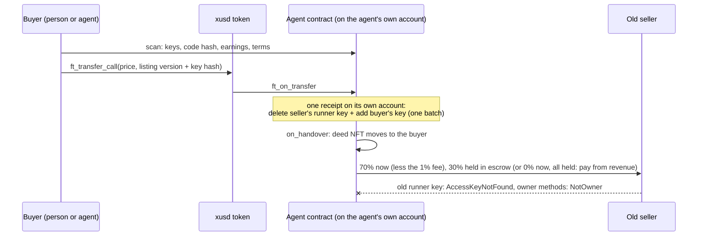

# Agent Exit: details

Moved from the README to keep it short. Paths are relative to the repo root.

## One sale

## Evidence

The long version, with every link: "Evidence" in [`docs/PROOF.md`](PROOF.md#evidence).

- **Real node:** the handover tests passed on a local NEAR node at commits `609b135` and `63d597c` (`make test-sandbox`; not yet re-run green on the current code); the sealed-prompt dispute too (`make test-sealed-sandbox`).
- **Offline, every run:** 76 checks through the real contract code against checked-in goldens (`make verify`), property tests, 205 MCP tests. Attack suite: 20 attack families, 19 counted (A9 Base not counted until live); each blocked by its rule; 0/50 false positives. It is a regression suite, not independent evidence, written by the same author. The code-hash check uses the reproducible build in `contracts/res/SHA256SUMS`.
- **Found and fixed on a real node:** a stress run bricked an agent at about 585 payers; the cause is unconfirmed. The fix keeps payer rows out of the state blob (test `a47_thousand_long_payers_then_buy_and_views`). A payer row now costs 0.024 NEAR (`storage_deposit`).
- **Live on NEAR testnet:** scenes 1-13, gates G1 and G6 and the AI buyer, on `agentexit6.testnet` (the cheat's listing refused `NotBornClean`); the MCP agent that invests by a fixed rule is recorded on the earlier world `agentexit5.testnet`. Every testnet transaction: [`docs/TESTNET.md`](TESTNET.md).

## Try it in 2 minutes (do X, see Y)

The page's "Try to cheat it" tabs (Invest, Hide a backdoor, Honest sale, Buy the brain) are the four rows at the top of the [README](../README.md). Three more checks below. More of the business (earnings by payer, pay from revenue, spending limits) is in [The business layer](#the-business-layer). Offline: `cargo test -p playground`. Everything else: `make setup` once, then `make demo` (offline story) and `make web` (the page at http://127.0.0.1:8080).

| Do | See |
|---|---|
| Tab "Hide a backdoor": "Buy without a clean scan", then "Take the agent back" | the hidden key redeploys and the seller has the agent back: the scan is the defence |
| `make check-account ID=trading-bot.testnet` (or MCP `check_account`) on `trading-bot.testnet`, `locked-vault.testnet`, then `translator.factory.testnet` (or any testnet account, named or implicit, with the `agent-exit-testnet` server) | `backdoor_risk`: a full-access key on a contract and an `upgrade` method (also any key the contract never installed, or a NEAR global contract another account can swap); `no_key_unknown_code`: no key, but code we cannot check; `locked`: no key and the published build, which has no upgrade method |
| "Check it yourself": open a scenario, press "Run and verify" | each stage is fetched from NEAR testnet now (signer, method, outcome, the contract's event logs) and marked `confirmed on chain` |

## The business layer

What makes an agent worth investing in or buying. All on the same contract, all runnable on the page or with the `sandbox` tool:

| Do | See |
|---|---|
| `make business-loop` (offline, real contract code) | 30 days with no human after the setup: customers pay 1,555.00, dave gets exactly 10% (155.50), the runner buys 118 jobs from another agent inside its 8.00 daily cap; `PolicyViolation:DailyCap` and `PolicyViolation:Payee` refuse the rest (`out/business-loop.json`) |
| Tab "Fake revenue": "Pay your own agent 200" | `FLAGGED: the owner paid their own agent (not counted)`; counted revenue does not move |
| Tab "Invest": offer 20%, "Buy the 20% slice", a customer pays, alice pays herself | dave gets `5.00 to investors` and `40.00 to investors` inside the same calls; alice can't withdraw his part; a year later `245.00 of unreleased escrow back to dave` |
| Tab "Pay from revenue": list "paid only from revenue", buy, alice fakes 200 from a fresh wallet | `0.00 paid to alice now: all 1,000.00 is held`; then `paid 200.00 and got 100.00 back: faking revenue cost 100.00`: after a sale, faking always loses money |

## Rerun it (humans and AI agents)

Rust (pinned in `rust-toolchain.toml`), `make`, Node >= 20. No NEAR account and no network after `make setup`. Every command, with what it prints: [`docs/COMMANDS.md`](COMMANDS.md).

| Do | See |
|---|---|
| `make demo` | the offline story in one command: the verify replay and the scripted agent-buys-agent replay |
| `make verify` | unit and property tests, then the fixed world through the real contract code equals `tests/golden/verify.json` and `tests/golden/attack.json` |
| `make attack` | 200 seeded attack variants and 50 clean agents through the scan; 0/50 false positives |
| `make mcp-test` | the MCP server's 205 tests offline, then the scripted run equals `tests/golden/agent-buys-agent.json` |
| `make web` | the demo page at http://127.0.0.1:8080 (offline; `?network=testnet` reads live through a read-only relay) |
| `make test-sandbox`, `make test-sealed-sandbox` | the handover and the sealed-prompt dispute on a real local NEAR node |

